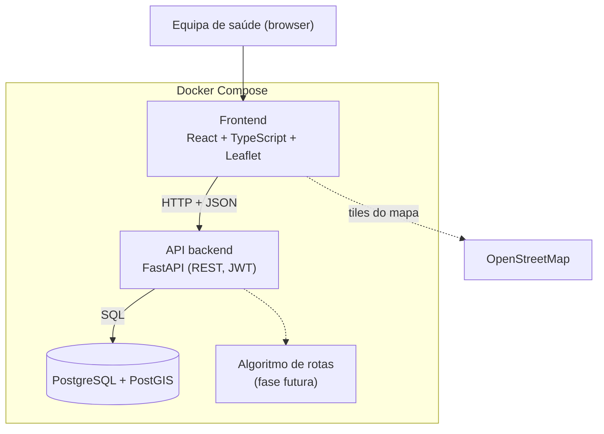
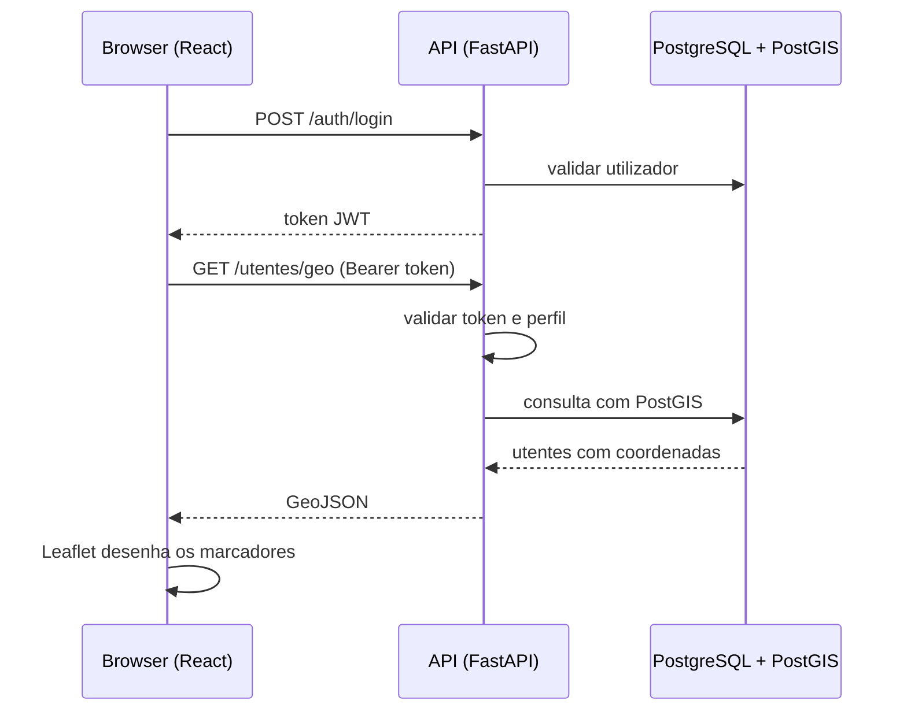

# Arquitetura

Plataforma de apoio à Equipa de Cuidados Paliativos da ULSBA. Arquitetura
cliente-servidor em três camadas, executada em Docker Compose.

## Visão geral

## Componentes

| Camada | Tecnologia | Responsabilidade |
|---|---|---|
| Frontend | React, TypeScript, Leaflet | Interface, mapa de utentes, pesquisa, agenda |
| Backend | FastAPI (Python) | Regras de negócio, autenticação, endpoints REST |
| Base de dados | PostgreSQL + PostGIS | Utentes, visitas, viaturas e dados geográficos |
| Mapas | OpenStreetMap | Mapa base, carregado diretamente pelo browser |
| Infraestrutura | Docker Compose | Ambiente igual para toda a equipa |

## Fluxo de um pedido

Regras principais:
- O frontend nunca acede diretamente à base de dados.
- A API é o único ponto de acesso aos dados e aplica as permissões.
- Os tiles do mapa vêm diretamente do OpenStreetMap para o browser.

## Portas (desenvolvimento)

| Serviço | Porta |
|---|---|
| Frontend | 5173 |
| API | 8000 |
| Base de dados | 5432 |

## Escolha das tecnologias

A proposta sugere ASP.NET Core para o backend e admite outras tecnologias,
desde que fundamentadas nos requisitos, nos conhecimentos da equipa e no prazo.

### FastAPI vs ASP.NET Core

| Critério | FastAPI (Python) | ASP.NET Core (C#) |
|---|---|---|
| Sugestão da proposta | Alternativa admitida | Sugerido explicitamente |
| Tempo de desenvolvimento | Rápido, pouca configuração | Mais estrutura e código |
| Documentação da API | Automática (`/docs`), útil para validar o contrato com o frontend | Swagger disponível |
| Validação de dados | Pydantic integrado | Data annotations / FluentValidation |
| Integração com PostGIS | GeoAlchemy2, Shapely | Npgsql + NetTopologySuite |
| Algoritmo de rotas | Ecossistema forte de otimização (OR-Tools, NetworkX) | Existe, menos comum |
| Tipagem | Type hints (opcional) | Forte, em compilação |

Decisão: **FastAPI**. Justificação: [PREENCHER com a razão real da equipa:
conhecimentos, prazo até fevereiro, linguagem do algoritmo da docente de
Matemática].

### PostgreSQL + PostGIS vs MySQL / SQL Server

- O PostGIS é a extensão geoespacial mais madura (`ST_Distance`,
  `ST_DWithin`, índices espaciais GiST), de código aberto.
- Georreferenciar utentes e calcular distâncias é central ao projeto.
- A imagem Docker `postgis/postgis` já vem pronta.
- O SQL Server implica licenciamento e imagem mais pesada. O MySQL tem
  funções espaciais mais limitadas.

Decisão: **PostgreSQL + PostGIS**.

## Segurança e perfis de acesso

- **Autenticação:** JWT com expiração curta. Palavras-passe guardadas com
  hash (argon2 ou bcrypt), nunca em texto simples.
- **Perfis:** `admin`, `coordenador`, `enfermeiro` (a validar com a equipa de
  cuidados paliativos). As permissões por rota estão em `docs/endpoints.md`
  e são verificadas **no backend**, não só no frontend.
- **Validação de entradas:** modelos Pydantic e queries parametrizadas,
  contra injeção SQL.
- **CORS** restrito à origem do frontend.
- **Segredos** no `.env`, fora do Git.
- **Auditoria:** registo de quem consultou ou alterou fichas de utentes.
- **Dados fictícios** em todo o desenvolvimento, por proteção de dados
  clínicos (RGPD). Não há integração com sistemas da ULSBA nesta fase.

## Evolução futura

Integração do algoritmo de otimização de rotas (conceção pela docente de
Matemática). Nesta fase o backend apenas expõe a extração dos dados
necessários (`GET /rotas/dados`).