# Desenho do Modelo de Dados — Plataforma de Cuidados Paliativos ULSBA

**Projeto:** Projeto Integrado 2026–2027 · Engenharia Informática · IPBeja  
**Referência funcional:** [`docs/requisitos.md`](requisitos.md) — Especificação de Requisitos v0.3, de 31/10/2026, incluindo as alterações discutidas na reunião de 28/10/2026  
**Versão do modelo:** 1.0 · 01/11/2026 · Proposta para revisão da equipa e da docente  
**Tecnologias previstas:** PostgreSQL 16, PostGIS 3, API FastAPI e frontend React/TypeScript  
**Âmbito:** modelo conceptual, modelo lógico, dicionário de dados e regras de integridade.

> **Estado da proposta:** este documento descreve o desenho de dados a validar e implementar. Não atesta que as tabelas, restrições, rotinas ou migrações tenham sido executadas. As regras clínicas e operacionais ainda pendentes de validação pela ULSBA continuam identificadas como provisórias, conforme `docs/requisitos.md`.

---

## 1. Objetivo e princípios de modelação

A base de dados deve permitir registar e consultar utentes, locais, avaliações clínicas, equipas, profissionais e viaturas; apoiar o planeamento de **voltas**, **paragens** e **visitas**; preservar ocorrências, históricos e autoria; e fornecer informação geográfica em WGS84 para o mapa e para exportação técnica. A escolha de tabelas prioriza integridade, normalização e rastreabilidade, sem assumir regras clínicas ainda não confirmadas.

**Decisões nucleares:**

1. **Locais partilhados:** `utente.local_id → local.id`. Dois utentes no mesmo lar não duplicam a morada nem a coordenada (RF05).
2. **Cuidador Principal ≠ Equipa Responsável ≠ Equipa Executante:** são entidades/associações independentes (RF02, RF24, RF33).
3. **Urgência ≠ IPCPAL ≠ PPS:** três históricos independentes; nunca deduzir IPCPAL a partir do PPS sem validação clínica (RF10–RF14).
4. **Equipa ≠ escala ≠ participantes:** a pertença à equipa, a disponibilidade temporal e a participação efetiva em visitas são relações distintas (RF21, RF24).
5. **Volta → paragem → visita:** uma paragem pode agrupar visitas de utentes no mesmo local; uma visita pendente pode existir sem paragem e sem horários (RF23, RF43, RF50).
6. **Rascunho versus confirmação:** recursos e visitas são opcionais no rascunho, mas obrigatórios e validados na confirmação (RF43, RF50).
7. **Dados geográficos:** `geography(Point,4326)` (longitude/latitude), GiST e perímetros administrativos apenas quando confirmados; distâncias rodoviárias não se inferem de linhas retas (RF04, RF25, RNF27).
8. **Histórico e autoria:** avaliações e ocorrências têm registos novos para retificações; auditoria não é substituída pelo histórico de visitas (RF10, RF45, RNF04).
9. **Segurança:** FKs e tabelas não substituem permissões por perfil/equipa/utente no backend; apenas dados fictícios na sandbox (RF37, RF49, RNF01, RNF22).

**Dimensão proposta:** **32 entidades e 252 atributos**, incluindo `mensagem` (funcionalidade *Could*), `escala_profissional` (disponibilidade operacional) e `territorio_cobertura` (validação geográfica condicionada). Os campos `paragem.geom_planeada` e `paragem.coordenada_registada_em` destinam-se a preservar a localização utilizada no planeamento. As entidades e campos condicionados dependem de decisão da equipa e de validação das respetivas regras.

### 1.1. Decisões da reunião de 28/10 e impacto no modelo

A documentação final dos requisitos distingue pedidos de interface de obrigações de persistência. A estrutura de dados **não deve ser moldada apenas pelo protótipo React**: deve permitir os fluxos reais definidos nos RF, mantendo historial e autorizações na API.

| Decisão / fluxo observado | Consequência no modelo de dados | RF |
|---|---|---|
| Dashboard mantém **Cuidador Principal** e troca **Médico Assistente** por **Equipa Responsável** | `cuidador_principal` e `atribuicao_equipa_responsavel` independentes; equipa executante não é a responsável | RF02, RF24, RF33 |
| Listagem com complexidade, equipa responsável e filtro «última visita entre datas», incluindo «sem visitas» | Dados derivados das avaliações e visitas concluídas; evitar colunas duplicadas em `utente` | RF08, RF12, RF30 |
| Alteração de prioridade diretamente na listagem | Inserir `avaliacao_triagem` com motivo, autor e instante; não substituir a linha anterior | RF08, RF10 |
| Agenda com vistas Unidade, Utente e Profissional | `volta`, `paragem`, `visita`, `volta_profissional` e `visita_participante`; horários da volta diferentes dos horários da visita | RF19, RF21, RF24 |
| Detalhe da volta num **único ecrã, sem submenus** | Consultas às voltas, paragens, visitas e ocorrências; **o histórico persiste** mesmo sem separador dedicado | RF43–RF45 |
| Criar volta a partir do calendário, mantendo painel e campos do rascunho | `volta.data` e `volta.estado`; recursos e horários opcionais no rascunho; confirmação com equipa, viatura, horários e >=1 visita | RF43, RF50 |
| Viaturas com «Agendar» manutenção/indisponibilidade | `viatura_indisponibilidade` guarda intervalos; disponibilidade deve consultar reserva e bloqueios | RF20, RF48, RF50 |
| Ecrã **Equipas** mostra composição e viatura habitual | `equipa_membro` e `equipa.viatura_habitual_id`, sem confundir a viatura habitual com `volta.viatura_id` | RF24, RF52 |
| Duração prevista decorre da **complexidade**, não da urgência | `duracao_padrao_complexidade` versionada; `avaliacao_complexidade` independente de `avaliacao_triagem` e `registo_pps` | RF10–RF14, RF39 |
| Relatório de impressão da volta (*Should*) | Consultas dos dados existentes, com campos nulos claramente apresentados; **não exige uma nova tabela** | RF51 |

**Regra de interpretação:** as sugestões da docente e o frontend não constituem confirmação operacional da ULSBA. A configuração clínica, os horários e as regras de exceção mantêm-se provisórios nos termos da secção 8 dos requisitos.

## 2. Notação ER e leitura dos diagramas

| Símbolo / conceito | Significado |
|---|---|
| `1:1` | Um registo corresponde a um registo. |
| `1:0..1` | Um registo pode ter zero ou um registo relacionado. |
| `1:N` | Um registo pode relacionar-se com vários. |
| `PK` | Chave primária (identifica um registo). |
| `FK` | Chave estrangeira (referencia outra tabela). |
| `UQ` / `UK` | Valor ou combinação de valores únicos. |
| `NN` | Campo obrigatório (`NOT NULL`). |
| `timestamptz` | Instante temporal com informação de fuso (apresentar em Europe/Lisbon). |
| `geography(Point,4326)` | Tipo espacial WGS84; armazena um ponto lon/lat e calcula distâncias geodésicas em metros. |

**Todos os diagramas abaixo estão em blocos `mermaid` diretamente incorporados neste ficheiro**. As vistas conceptuais usam retângulos (entidades) e losangos (relacionamentos) segundo uma adaptação da notação de Chen. As vistas lógicas usam `erDiagram` com cardinalidades Crow’s Foot. Os diagramas por domínio reduzem os cruzamentos; as cardinalidades e exceções estão documentadas também em tabelas.

## 3. Diagramas ER — conceptual, relacional completo e por domínio

### 3.1. Modelo ER conceptual **completo** — notação de Chen

Este é o **diagrama conceptual global da proposta**, com as **32 entidades** presentes no dicionário e **39 associações**. Usa retângulos para as entidades e losangos para os relacionamentos, segundo uma adaptação da notação de Chen. O GitHub gera o desenho a partir do código Mermaid, sem ficheiros de imagem; para relações mais legíveis consulta também os diagramas por domínio abaixo.

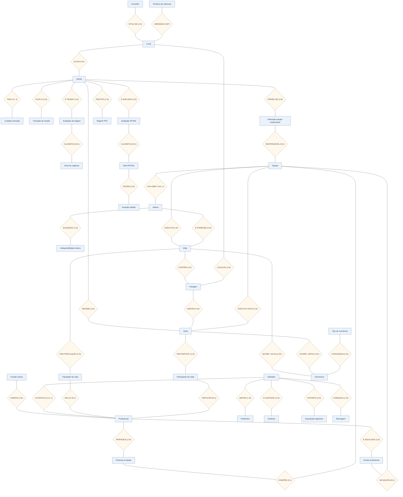

#### 3.1.1. Relações e cardinalidades do modelo conceptual global

As cardinalidades seguintes indicam as relações de negócio **propostas**. Quando a associação é opcional em rascunho (equipa/viatura/paragem da volta), esta condição prevalece sobre a cardinalidade resumida do diagrama. O histórico e as associações N:M aparecem como **entidades associativas/eventos** para tornar a proposta integralmente rastreável à base relacional.

| Entidade A | Relacionamento | Entidade B | Cardinalidade |
|---|---|---|---|
| `concelho` | Situa-se em | `local` | 1:N |
| `territorio_cobertura` | Abrange espacialmente | `local` | N:M* |
| `local` | Aloja | `utente` | 1:N |
| `utente` | Tem cuidador | `cuidador_principal` | 1:0..1 |
| `utente` | Muda de estado | `utente_transicao_estado` | 1:N |
| `utente` | É triado | `avaliacao_triagem` | 1:N |
| `avaliacao_triagem` | Classifica urgência | `nivel_urgencia` | N:1 |
| `utente` | É avaliado IPCPAL | `avaliacao_complexidade` | 1:N |
| `avaliacao_complexidade` | Classifica IPCPAL | `nivel_complexidade` | N:1 |
| `utente` | Regista PPS | `registo_pps` | 1:N |
| `utente` | Tem atribuição | `atribuicao_equipa_responsavel` | 1:N |
| `atribuicao_equipa_responsavel` | É responsável | `equipa` | N:1 |
| `funcao_profissional` | Exerce função | `profissional` | 1:N |
| `utilizador` | Associa conta | `profissional` | 1:0..1 |
| `profissional` | Integra composição | `equipa_membro` | 1:N |
| `equipa_membro` | Compõe | `equipa` | N:1 |
| `profissional` | Cumpre escala | `escala_profissional` | 1:N |
| `escala_profissional` | Escalado em | `equipa` | N:1 |
| `equipa` | Utiliza habitualmente | `viatura` | N:0..1 |
| `viatura` | Tem indisponibilidade | `viatura_indisponibilidade` | 1:N |
| `equipa` | Executa volta | `volta` | 1:N |
| `viatura` | É atribuída | `volta` | 1:N |
| `volta` | Contém | `paragem` | 1:N |
| `local` | Localiza paragem | `paragem` | 1:N |
| `utente` | Recebe visita | `visita` | 1:N |
| `paragem` | Agrupa visitas | `visita` | 1:N |
| `equipa` | Executa visita | `visita` | 1:N |
| `volta` | Tem tripulação | `volta_profissional` | 1:N |
| `volta_profissional` | Inclui profissional | `profissional` | N:1 |
| `visita` | Tem participante | `visita_participante` | 1:N |
| `visita_participante` | É profissional | `profissional` | N:1 |
| `volta` | Ocorrência da volta | `ocorrencia` | 1:N† |
| `visita` | Ocorrência da visita | `ocorrencia` | 1:N† |
| `tipo_ocorrencia` | Categoriza | `ocorrencia` | 1:N |
| `nivel_complexidade` | Define duração | `duracao_padrao_complexidade` | 1:N |
| `utilizador` | Define parâmetros | `parametro_sistema` | 1:N |
| `utilizador` | É autor auditado | `auditoria` | 1:N |
| `utilizador` | Gera exportação | `exportacao_algoritmo` | 1:N |
| `utilizador` | Envia mensagem | `mensagem` | 1:N |

**Legenda de exceções:** `*` a ligação `territorio_cobertura`–`local` representa uma **verificação de pertença espacial** (`ST_Covers`/`ST_Intersects`), não uma FK obrigatória nem um catálogo territorial já aprovado. `†` uma ocorrência referencia **ou** uma volta **ou** uma visita, nunca ambas simultaneamente (`num_nonnulls(...) = 1`). A mensagem é *Could* e o território está pendente de aprovação institucional.

**Autoria:** os relacionamentos técnicos de autoria (`avaliada_por`, `criada_por`, `confirmada_por`, etc.) estão no **dicionário e nas FKs do modelo lógico**. Para evitar dezenas de linhas sobrepostas no conceptual, o diagrama global resume a relação com `utilizador` nas entidades de suporte. Isto não elimina os campos de autoria nos restantes registos.

**Regras complementares:** a atribuição de equipa responsável tem intervalos históricos; `equipa_membro` não substitui `escala_profissional`; `volta_profissional` não substitui `visita_participante`; uma volta confirmada exige recursos e visitas válidos, enquanto um rascunho pode estar vazio (RF21, RF24, RF43, RF50). A noção de *completo* refere-se às entidades e associações conceptuais documentadas, **não à implementação integral das regras SQL**.

### 3.2. Modelo ER conceptual — notação de Peter Chen (visão nuclear)

Antes de apresentar as tabelas e as chaves estrangeiras, o **modelo conceptual** identifica as entidades do domínio e os relacionamentos de negócio, sem depender da implementação PostgreSQL. Segue-se a **notação de Chen simplificada**: **retângulo** = entidade, **losango** = relacionamento e rótulos junto às ligações = cardinalidades. Esta vista é intencionalmente nuclear; o restante modelo encontra-se nos diagramas lógicos por área.

**Relações representadas:**

| Relacionamento | Cardinalidade conceptual | Observação |
|---|---|---|
| Local **aloja** Utente | Local (1) — Utente (0..N) | Cada utente possui **um** local atual; vários utentes podem estar no mesmo lar (RF05). |
| Utente **recebe** Visita | Utente (1) — Visita (0..N) | Uma visita é de um utente; pode ainda não estar planeada (RF23, RF29). |
| Equipa **executa** Volta | Equipa (1) — Volta (0..N) | A associação da equipa numa volta **em rascunho é opcional**; torna-se obrigatória ao confirmar (RF43, RF50). |
| Volta **contém** Paragem | Volta (1) — Paragem (0..N) | Rascunhos podem não ter paragens; cada paragem pertence a uma volta. |
| Paragem **agrupa** Visita | Paragem (1) — Visita (0..N) | A visita pendente pode não ter paragem. Uma paragem pode agrupar visitas a utentes do mesmo lar (RF21). |

**Outras relações deliberadamente omitidas desta vista simplificada para evitar cruzamentos:** cada paragem referencia um local; a equipa responsável acompanha um utente ao longo de períodos de validade; a viatura é atribuída por volta; e os profissionais participam através de associações próprias. Estas relações aparecem nos diagramas lógicos seguintes e no dicionário de dados. As cardinalidades **não substituem** as regras de validação de confirmação e conflitos de recursos.

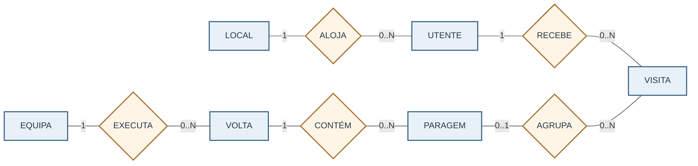

### 3.3. Modelo ER conceptual — avaliações clínicas independentes

A urgência de triagem, a classificação IPCPAL e a escala PPS são **três percursos de avaliação distintos**, com autoria e histórico separados (RF10–RF12). Este segundo diagrama mostra os eventos de avaliação, antes da conversão para tabelas relacionais.

Cada utente pode ter **zero ou várias** avaliações de triagem, zero ou várias avaliações de complexidade e zero ou vários registos PPS. Cada avaliação de triagem associa-se a um nível de urgência e cada avaliação de complexidade a um nível IPCPAL; **um registo PPS não implica uma avaliação IPCPAL nem a sua conversão automática**. As retificações são históricas e auditadas (RF10, RF14, RNF04).

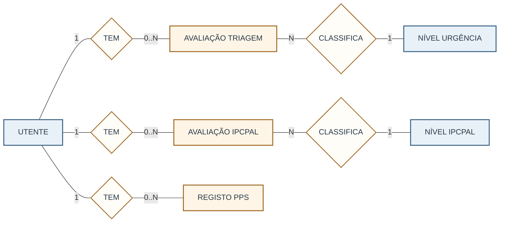

### 3.4. Modelo ER relacional completo — tabelas, atributos, PK/FK e cardinalidades

Este diagrama representa **as 32 tabelas propostas**, os seus **252 atributos** e todas as relações de **chave estrangeira (FK)** definidas no dicionário de dados. Ao contrário do diagrama conceptual de Chen, cada retângulo corresponde aqui a uma **tabela relacional** e as ligações utilizam a notação **Crow’s Foot**.

**Como ler:** `PK` é a chave primária; `FK` identifica uma chave estrangeira; `UK` indica unicidade adicional. Os tipos no diagrama aparecem sem comprimento ou precisão (por exemplo, `varchar` em vez de `varchar(120)`), exclusivamente para facilitar a renderização. **Os tipos exatos, `NOT NULL`, valores por omissão e restrições estão especificados na secção 6 — Dicionário de dados.** O nome junto da linha corresponde à coluna FK na tabela dependente.

O gráfico é extenso porque contém todas as colunas e relações, incluindo as referências de autoria a `utilizador`. Para analisar cada área com mais facilidade, devem consultar-se as vistas por domínio nas secções seguintes.

```mermaid
erDiagram
    direction TB
    CONCELHO {
        integer id PK
        varchar nome UK
        varchar distrito
    }

    NIVEL_URGENCIA {
        integer id PK
        varchar codigo UK
        varchar designacao
        char cor_hex
        varchar icone
        smallint ordem UK
        smallint prazo_max_sem_visita_dias
        boolean ativo
    }

    NIVEL_COMPLEXIDADE {
        integer id PK
        varchar codigo UK
        varchar designacao
        smallint ordem UK
        boolean ativo
    }

    LOCAL {
        integer id PK
        tipo_local tipo
        varchar nome
        varchar morada
        varchar codigo_postal
        varchar localidade
        integer concelho_id FK
        varchar contacto_telefonico
        geography geom
        origem_coordenadas origem_coordenadas
        boolean coordenadas_confirmadas
        boolean ativo
        timestamptz criado_em
    }

    TERRITORIO_COBERTURA {
        integer id PK
        varchar nome
        geometry geom
        varchar origem
        boolean aprovado
        date valido_desde
        timestamptz registado_em
    }

    UTENTE {
        integer id PK
        varchar numero_utente UK
        varchar nome
        genero genero
        date data_nascimento
        integer local_id FK
        varchar contacto_telefonico
        text situacao_clinica
        text notas
        estado_utente estado
        timestamptz criado_em
        integer criado_por FK
    }

    CUIDADOR_PRINCIPAL {
        integer id PK
        integer utente_id FK,UK
        varchar nome
        varchar parentesco
        varchar contacto_telefonico
        timestamptz criado_em
    }

    UTENTE_TRANSICAO_ESTADO {
        integer id PK
        integer utente_id FK
        estado_utente estado_anterior
        estado_utente estado_novo
        date data_transicao
        varchar motivo
        integer registada_por FK
        timestamptz registada_em
    }

    AVALIACAO_TRIAGEM {
        integer id PK
        integer utente_id FK
        integer nivel_urgencia_id FK
        varchar motivo
        timestamptz avaliada_em
        integer avaliada_por FK
        integer retifica_id FK
    }

    AVALIACAO_COMPLEXIDADE {
        integer id PK
        integer utente_id FK
        integer nivel_complexidade_id FK
        timestamptz avaliada_em
        integer avaliada_por FK
        varchar observacao
    }

    REGISTO_PPS {
        integer id PK
        integer utente_id FK
        smallint valor
        timestamptz registado_em
        integer registado_por FK
        varchar observacao
    }

    ATRIBUICAO_EQUIPA_RESPONSAVEL {
        integer id PK
        integer utente_id FK
        integer equipa_id FK
        timestamptz valido_desde
        timestamptz valido_ate
        varchar motivo
        integer registada_por FK
        timestamptz registada_em
    }

    UTILIZADOR {
        integer id PK
        varchar email
        varchar nome
        varchar password_hash
        perfil_utilizador perfil
        boolean vista_geral
        boolean ativo
        smallint tentativas_falhadas
        timestamptz bloqueado_ate
        timestamptz ultimo_acesso_em
        timestamptz criado_em
    }

    FUNCAO_PROFISSIONAL {
        integer id PK
        varchar codigo UK
        varchar designacao
        boolean ativo
    }

    VIATURA {
        integer id PK
        varchar matricula UK
        varchar designacao
        tipo_motorizacao tipo_motorizacao
        smallint lugares
        numeric capacidade_deposito
        unidade_deposito unidade_deposito
        numeric autonomia
        unidade_autonomia unidade_autonomia
        estado_viatura estado
        date data_ultima_revisao
        smallint periodicidade_revisao_meses
        timestamptz criada_em
    }

    VIATURA_INDISPONIBILIDADE {
        integer id PK
        integer viatura_id FK
        tipo_indisponibilidade tipo
        timestamptz inicio
        timestamptz fim
        varchar descricao
        integer criada_por FK
        timestamptz criada_em
    }

    PROFISSIONAL {
        integer id PK
        integer utilizador_id FK,UK
        varchar nome
        integer funcao_id FK
        varchar contacto_telefonico
        boolean ativo
        timestamptz criado_em
    }

    EQUIPA {
        integer id PK
        varchar codigo UK
        varchar designacao
        integer viatura_habitual_id FK
        boolean ativa
        timestamptz criada_em
    }

    EQUIPA_MEMBRO {
        integer id PK
        integer equipa_id FK
        integer profissional_id FK
        timestamptz valido_desde
        timestamptz valido_ate
    }

    ESCALA_PROFISSIONAL {
        integer id PK
        integer profissional_id FK
        integer equipa_id FK
        timestamptz inicio
        timestamptz fim
        varchar observacao
        integer registada_por FK
        timestamptz registada_em
    }

    TIPO_OCORRENCIA {
        integer id PK
        varchar codigo UK
        varchar designacao
        visibilidade_ocorrencia visibilidade_padrao
        boolean ativo
    }

    VOLTA {
        integer id PK
        date data
        varchar designacao
        estado_volta estado
        integer equipa_id FK
        integer viatura_id FK
        integer local_base_id FK
        timestamptz partida_prevista
        timestamptz regresso_previsto
        timestamptz partida_real
        timestamptz regresso_real
        numeric distancia_estimada_km
        metodo_distancia metodo_distancia
        numeric distancia_real_km
        fonte_distancia_real fonte_distancia_real
        origem_plano origem_plano
        varchar motivo_cancelamento
        integer criada_por FK
        timestamptz criada_em
        integer confirmada_por FK
        timestamptz confirmada_em
    }

    VOLTA_PROFISSIONAL {
        integer volta_id PK,FK
        integer profissional_id PK,FK
    }

    PARAGEM {
        integer id PK
        integer volta_id FK
        smallint ordem
        integer local_id FK
        numeric distancia_desde_anterior_km
        geography geom_planeada
        timestamptz coordenada_registada_em
    }

    VISITA {
        integer id PK
        integer utente_id FK
        integer paragem_id FK
        integer equipa_executante_id FK
        estado_visita estado
        timestamptz inicio_previsto
        timestamptz fim_previsto
        smallint duracao_estimada_min
        timestamptz inicio_real
        timestamptz fim_real
        numeric duracao_real_min
        boolean duracao_suspeita_confirmada
        varchar excecao_horario_motivo
        integer excecao_confirmada_por FK
        varchar motivo_cancelamento
        integer criada_por FK
        timestamptz criada_em
    }

    VISITA_PARTICIPANTE {
        integer visita_id PK,FK
        integer profissional_id PK,FK
    }

    OCORRENCIA {
        integer id PK
        integer volta_id FK
        integer visita_id FK
        integer tipo_ocorrencia_id FK
        visibilidade_ocorrencia visibilidade
        text texto
        smallint minutos_atraso
        integer autor_id FK
        timestamptz criada_em
        integer retifica_id FK
    }

    PARAMETRO_SISTEMA {
        integer id PK
        varchar chave
        varchar valor
        tipo_valor_parametro tipo_valor
        varchar descricao
        timestamptz valido_desde
        integer definido_por FK
    }

    DURACAO_PADRAO_COMPLEXIDADE {
        integer id PK
        integer nivel_complexidade_id FK
        smallint minutos
        timestamptz valido_desde
        integer definido_por FK
    }

    AUDITORIA {
        bigint id PK
        varchar entidade
        varchar entidade_id
        operacao_auditoria operacao
        integer utilizador_id FK
        timestamptz instante
        jsonb valores_anteriores
        jsonb valores_novos
        varchar motivo
    }

    EXPORTACAO_ALGORITMO {
        integer id PK
        varchar versao_contrato
        date intervalo_inicio
        date intervalo_fim
        integer numero_paragens
        boolean matriz_distancias_disponivel
        char hash_sha256
        integer gerada_por FK
        timestamptz gerada_em
    }

    MENSAGEM {
        integer id PK
        integer remetente_id FK
        integer destinatario_id FK
        varchar assunto
        text corpo
        timestamptz enviada_em
        timestamptz lida_em
    }

    CONCELHO ||--o{ LOCAL : "concelho_id"
    LOCAL ||--o{ UTENTE : "local_id"
    UTILIZADOR ||--o{ UTENTE : "criado_por"
    UTENTE ||--o| CUIDADOR_PRINCIPAL : "utente_id"
    UTENTE ||--o{ UTENTE_TRANSICAO_ESTADO : "utente_id"
    UTILIZADOR ||--o{ UTENTE_TRANSICAO_ESTADO : "registada_por"
    UTENTE ||--o{ AVALIACAO_TRIAGEM : "utente_id"
    NIVEL_URGENCIA ||--o{ AVALIACAO_TRIAGEM : "nivel_urgencia_id"
    UTILIZADOR ||--o{ AVALIACAO_TRIAGEM : "avaliada_por"
    AVALIACAO_TRIAGEM o|--o{ AVALIACAO_TRIAGEM : "retifica_id"
    UTENTE ||--o{ AVALIACAO_COMPLEXIDADE : "utente_id"
    NIVEL_COMPLEXIDADE ||--o{ AVALIACAO_COMPLEXIDADE : "nivel_complexidade_id"
    UTILIZADOR ||--o{ AVALIACAO_COMPLEXIDADE : "avaliada_por"
    UTENTE ||--o{ REGISTO_PPS : "utente_id"
    UTILIZADOR ||--o{ REGISTO_PPS : "registado_por"
    UTENTE ||--o{ ATRIBUICAO_EQUIPA_RESPONSAVEL : "utente_id"
    EQUIPA ||--o{ ATRIBUICAO_EQUIPA_RESPONSAVEL : "equipa_id"
    UTILIZADOR ||--o{ ATRIBUICAO_EQUIPA_RESPONSAVEL : "registada_por"
    VIATURA ||--o{ VIATURA_INDISPONIBILIDADE : "viatura_id"
    UTILIZADOR ||--o{ VIATURA_INDISPONIBILIDADE : "criada_por"
    UTILIZADOR o|--o| PROFISSIONAL : "utilizador_id"
    FUNCAO_PROFISSIONAL ||--o{ PROFISSIONAL : "funcao_id"
    VIATURA o|--o{ EQUIPA : "viatura_habitual_id"
    EQUIPA ||--o{ EQUIPA_MEMBRO : "equipa_id"
    PROFISSIONAL ||--o{ EQUIPA_MEMBRO : "profissional_id"
    PROFISSIONAL ||--o{ ESCALA_PROFISSIONAL : "profissional_id"
    EQUIPA ||--o{ ESCALA_PROFISSIONAL : "equipa_id"
    UTILIZADOR ||--o{ ESCALA_PROFISSIONAL : "registada_por"
    EQUIPA o|--o{ VOLTA : "equipa_id"
    VIATURA o|--o{ VOLTA : "viatura_id"
    LOCAL o|--o{ VOLTA : "local_base_id"
    UTILIZADOR ||--o{ VOLTA : "criada_por"
    UTILIZADOR o|--o{ VOLTA : "confirmada_por"
    VOLTA ||--o{ VOLTA_PROFISSIONAL : "volta_id"
    PROFISSIONAL ||--o{ VOLTA_PROFISSIONAL : "profissional_id"
    VOLTA ||--o{ PARAGEM : "volta_id"
    LOCAL ||--o{ PARAGEM : "local_id"
    UTENTE ||--o{ VISITA : "utente_id"
    PARAGEM o|--o{ VISITA : "paragem_id"
    EQUIPA o|--o{ VISITA : "equipa_executante_id"
    UTILIZADOR o|--o{ VISITA : "excecao_confirmada_por"
    UTILIZADOR ||--o{ VISITA : "criada_por"
    VISITA ||--o{ VISITA_PARTICIPANTE : "visita_id"
    PROFISSIONAL ||--o{ VISITA_PARTICIPANTE : "profissional_id"
    VOLTA o|--o{ OCORRENCIA : "volta_id"
    VISITA o|--o{ OCORRENCIA : "visita_id"
    TIPO_OCORRENCIA ||--o{ OCORRENCIA : "tipo_ocorrencia_id"
    UTILIZADOR ||--o{ OCORRENCIA : "autor_id"
    OCORRENCIA o|--o{ OCORRENCIA : "retifica_id"
    UTILIZADOR ||--o{ PARAMETRO_SISTEMA : "definido_por"
    NIVEL_COMPLEXIDADE ||--o{ DURACAO_PADRAO_COMPLEXIDADE : "nivel_complexidade_id"
    UTILIZADOR ||--o{ DURACAO_PADRAO_COMPLEXIDADE : "definido_por"
    UTILIZADOR o|--o{ AUDITORIA : "utilizador_id"
    UTILIZADOR ||--o{ EXPORTACAO_ALGORITMO : "gerada_por"
    UTILIZADOR ||--o{ MENSAGEM : "remetente_id"
    UTILIZADOR ||--o{ MENSAGEM : "destinatario_id"
```

**Notas de integridade e interpretação:**

- `territorio_cobertura` é uma **entidade proposta e condicionada**: a associação aos locais é determinada por operações espaciais PostGIS, **não existe uma FK direta**. Por isso, a tabela surge sem ligação relacional no diagrama.
- A entidade `mensagem` é **opcional** (*Could*, RF36); `escala_profissional` está sujeita à validação da política de escalas; as coordenadas históricas da `paragem` são uma proposta de preservação do planeamento.
- As ligações de `volta` a `equipa` e `viatura`, de `visita` a `paragem` e algumas outras FKs podem ser **nulas em rascunho ou antes do agendamento**. O diagrama reflete a nulabilidade dos campos, mas as restrições condicionadas pelo estado têm de ser implementadas e testadas na API/BD (RF21, RF29, RF43, RF50).
- As retificações usam FKs autorreferenciais (`avaliacao_triagem.retifica_id` e `ocorrencia.retifica_id`). Uma ocorrência referencia **uma volta ou uma visita**, mas não ambas. A prevenção de inconsistências entre tabelas exige validações adicionais, conforme a secção 8.

### 3.5. Visão geral do percurso operacional

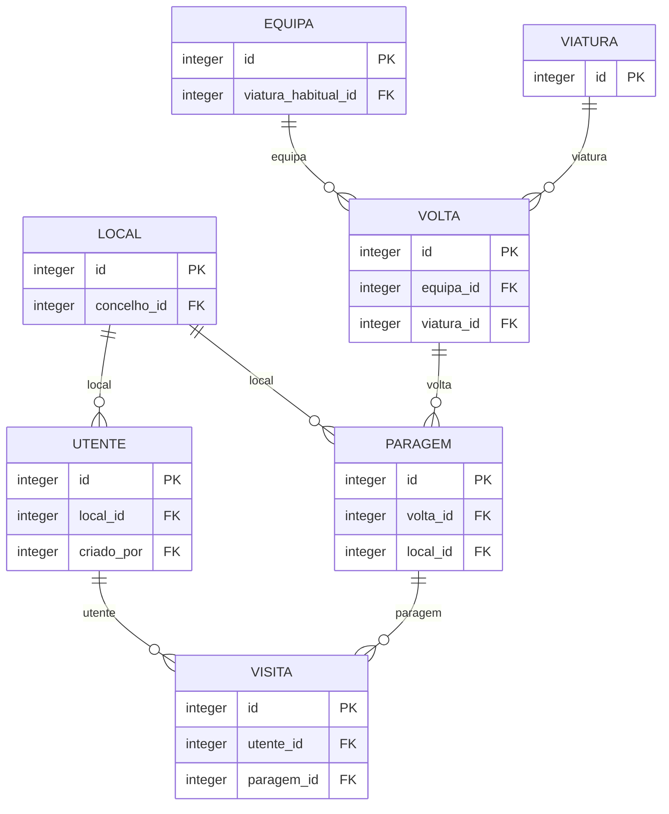

**Leitura:** uma equipa utiliza uma viatura numa volta; cada volta ordena paragens; cada paragem pode conter visitas de utentes do mesmo local. A visita pendente pode ainda não estar associada a uma paragem.

### 3.6. Utentes, localização e responsáveis

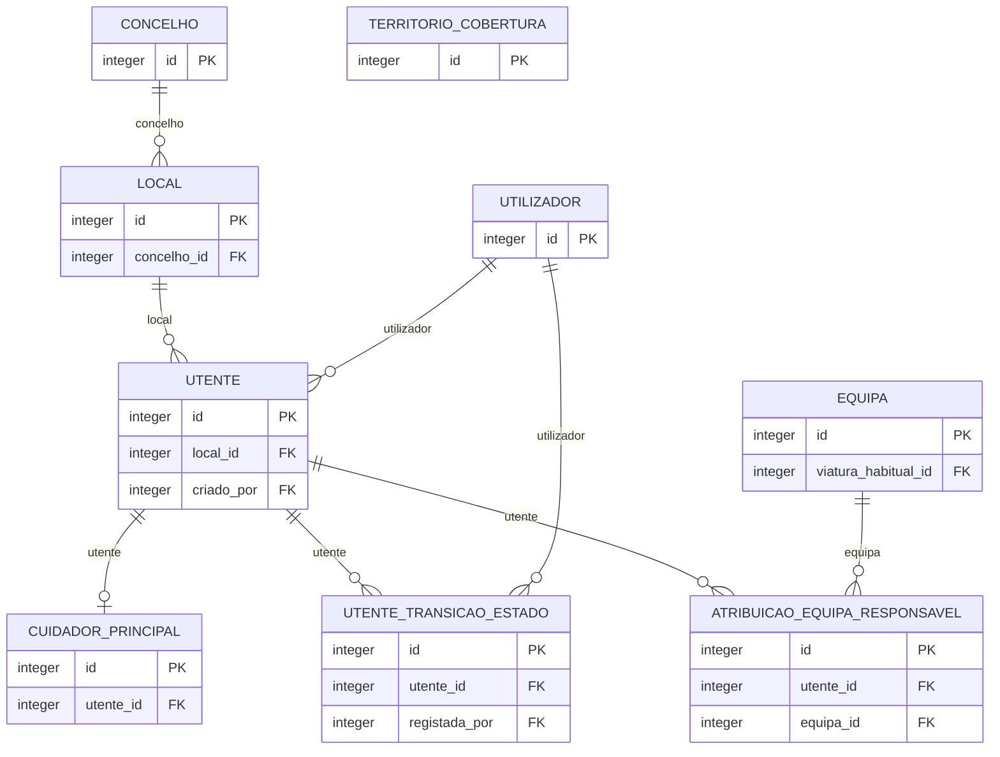

**Regra:** `local` é partilhável por muitos utentes. `territorio_cobertura` é uma referência espacial de validação, **não** uma FK obrigatória do utente.

### 3.7. Urgência, complexidade e PPS

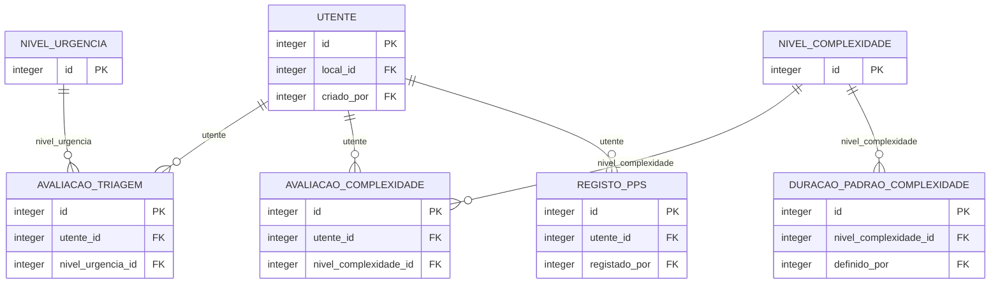

**Regra:** triagem (urgência), complexidade e PPS são avaliações distintas; a complexidade apoia durações, não determina a urgência.

### 3.8. Profissionais, equipas e viaturas

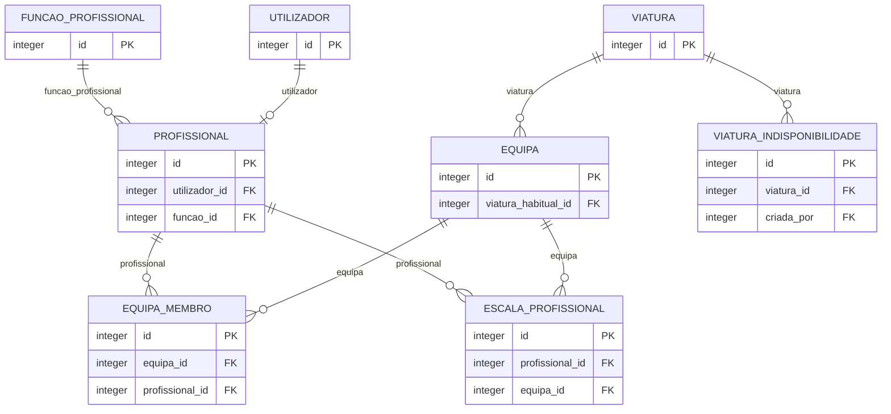

**Regra:** `equipa_membro` representa pertença; `escala_profissional`, a disponibilidade efetiva; `volta_profissional`, a tripulação planeada.

### 3.9. Voltas, paragens e visitas

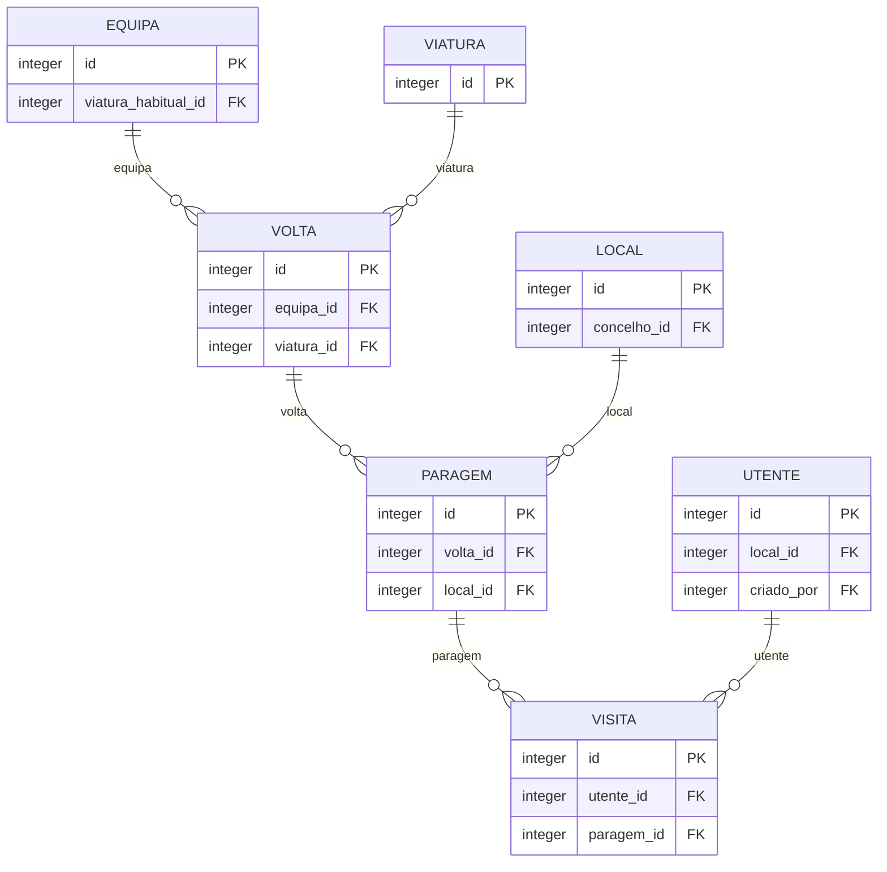

**Regra:** `visita.paragem_id` pode ser `NULL` numa visita pendente. Duas visitas no mesmo lar podem pertencer a uma só paragem, sem implicar execução clínica simultânea.

### 3.10. Tripulação da volta e participantes da visita

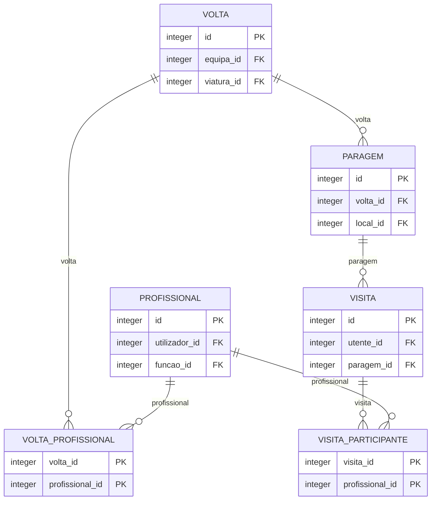

**Regra:** a tripulação da volta não substitui a lista de participantes efetivos de cada visita; ambas exigem validações temporais e de escala.

### 3.11. Ocorrências, configuração e auditoria

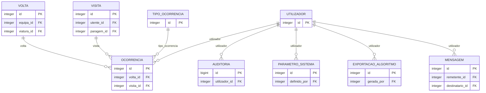

**Regra:** uma ocorrência tem **um único alvo**, visita ou volta; o registo de auditoria representa alterações críticas, não a própria consulta clínica.

## 4. Catálogo de entidades e relações principais

| Entidade | Finalidade | Principais relações |
|---|---|---|
| `utilizador` | Conta de acesso à plataforma. | Sem FK direta |
| `concelho` | Concelhos do território de atuação. | Sem FK direta |
| `nivel_urgencia` | Catálogo configurável de níveis de triagem/urgência. | Sem FK direta |
| `nivel_complexidade` | Catálogo da classificação de complexidade IPCPAL (altamente complexo, complexo, não complexo). | Sem FK direta |
| `funcao_profissional` | Catálogo das funções clínicas dos profissionais (médico, enfermeiro, …). | Sem FK direta |
| `tipo_ocorrencia` | Catálogo dos tipos de ocorrência (atraso, incidente, nota clínica, …), cada um com uma visibilidade por omissão. | Sem FK direta |
| `parametro_sistema` | Parâmetros de planeamento configuráveis, com histórico de quem os alterou e desde quando vigoram. | `utilizador` |
| `duracao_padrao_complexidade` | Duração padrão de uma visita por nível de complexidade, com histórico. | `nivel_complexidade`, `utilizador` |
| `viatura` | Viatura da unidade, com as características necessárias ao planeamento (lugares, depósito, autonomia, revisões). | Sem FK direta |
| `viatura_indisponibilidade` | Períodos em que uma viatura não pode ser usada (revisão, reparação, outro). | `viatura`, `utilizador` |
| `profissional` | Profissional de saúde com a sua função clínica. | `utilizador`, `funcao_profissional` |
| `equipa` | Equipa com código próprio (A, B, C, …) e viatura habitual opcional. | `viatura` |
| `equipa_membro` | Composição de uma equipa ao longo do tempo: que profissional pertence a que equipa e em que período. | `equipa`, `profissional` |
| `escala_profissional` | Escala de serviço efetiva por profissional e equipa, distinta da mera pertença à equipa. | `profissional`, `equipa`, `utilizador` |
| `local` | Local onde o utente se encontra ou de onde as equipas partem (domicílio, lar, unidade, base). | `concelho` |
| `territorio_cobertura` | Polígonos oficiais/versionados de validação geográfica. | Sem FK direta |
| `utente` | Utente (doente) acompanhado. | `local`, `utilizador` |
| `cuidador_principal` | Cuidador Principal: familiar ou outra pessoa que presta cuidados no domicílio. | `utente` |
| `utente_transicao_estado` | Histórico do ciclo de vida do utente. | `utente`, `utilizador` |
| `avaliacao_triagem` | Avaliações de triagem (urgência). | `utente`, `nivel_urgencia`, `utilizador`, `avaliacao_triagem` |
| `avaliacao_complexidade` | Avaliações de complexidade IPCPAL, separadas da triagem de urgência, com data e autor. | `utente`, `nivel_complexidade`, `utilizador` |
| `registo_pps` | Valores da Palliative Performance Scale (PPS), registados como valor independente da complexidade. | `utente`, `utilizador` |
| `atribuicao_equipa_responsavel` | Equipa Responsável pelo acompanhamento do utente, com histórico de atribuições. | `utente`, `equipa`, `utilizador` |
| `volta` | Agenda identificada de uma equipa num dia: viatura, partida e regresso previstos/reais, estado e sequência de paragens. | `equipa`, `viatura`, `local`, `utilizador`… |
| `volta_profissional` | Profissionais efetivamente escalados numa volta (por omissão, a composição da equipa nesse dia, ajustável). | `volta`, `profissional` |
| `paragem` | Paragem de uma volta: um local visitado numa determinada ordem. | `volta`, `local` |
| `visita` | Visita a um utente. | `utente`, `paragem`, `equipa`, `utilizador`… |
| `visita_participante` | Profissionais que efetivamente participaram numa visita. | `visita`, `profissional` |
| `ocorrencia` | Ocorrências e notas, ligadas a uma volta (ocorrências gerais) ou a uma visita, com visibilidade operacional ou clínica, autor e instante atribuídos pelo servidor. | `volta`, `visita`, `tipo_ocorrencia`, `utilizador`… |
| `auditoria` | Trilho de auditoria só de acrescentar: quem fez o quê, quando, a que entidade e com que valores antes e depois. | `utilizador` |
| `exportacao_algoritmo` | Registo de cada exportação de dados para o algoritmo de otimização de rotas, com a versão do contrato e uma impressão digital do ficheiro. | `utilizador` |
| `mensagem` | Mensagens internas entre membros da equipa. | `utilizador`, `utilizador` |

### 4.1. Cardinalidades e restrições semânticas relevantes

| Relação | Cardinalidade | Justificação / condição |
|---|---|---|
| `concelho` → `local` | 1:N | Um concelho contém vários locais. |
| `local` → `utente` | 1:N | Cada utente tem um local atual; vários utentes podem partilhar o mesmo. |
| `utente` → `cuidador_principal` | 1:0..1 | A identificação do cuidador é opcional. |
| `utente` → `avaliacao_triagem` | 1:N | Cada alteração de urgência é uma nova avaliação. |
| `utente` → `avaliacao_complexidade` | 1:N | Histórico IPCPAL independente. |
| `utente` → `registo_pps` | 1:N | Histórico PPS independente. |
| `utente` → `atribuicao_equipa_responsavel` | 1:N | O histórico permite mudanças de equipa; no máximo uma atribuição vigente por instante. |
| `equipa` → `equipa_membro` | 1:N | Pertença temporal de profissionais. |
| `profissional` → `escala_profissional` | 1:N | Disponibilidade de serviço efetiva. |
| `equipa` → `volta` | 1:N | Uma volta confirmada tem equipa; no rascunho a FK pode ser nula. |
| `viatura` → `volta` | 1:N | Uma viatura pode realizar voltas distintas em períodos não sobrepostos. |
| `volta` → `paragem` | 1:N | Zero paragens no rascunho; ordem de paragem obrigatória. |
| `local` → `paragem` | 1:N | O local pode ser visitado em várias voltas. |
| `paragem` → `visita` | 1:N | Pode conter várias visitas ao mesmo local; visita pendente sem paragem. |
| `utente` → `visita` | 1:N | Um utente pode ter um histórico de visitas. |
| `volta` → `volta_profissional` | 1:N | Tripulação planeada; respeitar lotação e escala. |
| `visita` → `visita_participante` | 1:N | Participantes reais e conflitos de simultaneidade. |
| `volta / visita` → `ocorrencia` | 1:N | Exclusividade: uma ocorrência pertence a exatamente um deles. |

## 5. Modelo físico proposto e opções de implementação

O modelo lógico define **32 entidades e 252 atributos** para discussão, com tipos PostgreSQL, chaves, relações e mecanismos de integridade propostos. A implementação deverá ser realizada através de migrações versionadas, conforme o RNF28. A inclusão de uma entidade no modelo conceptual não significa que a respetiva interface tenha prioridade *Must*.

| Elemento do desenho | Decisão e justificação | Requisitos |
|---|---|---|
| Entidades nucleares de utentes, locais, avaliações, recursos e planeamento | Estruturar os dados de forma normalizada, com relações explícitas e históricos independentes | RF02, RF05, RF10–RF12, RF19–RF24, RF43–RF50 |
| `escala_profissional` | **Proposta a validar:** representar a disponibilidade real por intervalo, separada de `equipa_membro` e `volta_profissional` | RF21, RF24 |
| `territorio_cobertura` | **Proposta condicionada:** guardar polígonos territoriais com origem e aprovação quando existirem limites geográficos validados | RF04, RNF27 |
| `paragem.geom_planeada`, `paragem.coordenada_registada_em` | **Proposta de histórico:** preservar as coordenadas usadas durante o planeamento, mesmo após correção do local | RF21, RF25, RF44 |
| `local.geom` | Utilizar `geography(Point,4326)` com índice GiST; para extrair longitude/latitude, converter em geometria com `ST_X(geom::geometry)` e `ST_Y(geom::geometry)` | RF04, RNF11, RNF27 |
| `mensagem` | Entidade de suporte opcional; a sua implementação funcional depende da priorização do RF36 (*Could*) | RF36 |

**Critério de implementação:** após validação do modelo, as regras que abrangem várias entidades devem ser implementadas em transações e, quando necessário, com restrições ou triggers da base de dados. As migrações devem ser criadas e versionadas juntamente com as alterações ao diagrama e ao dicionário (RNF28).

### 5.1. Regras de integridade a validar antes da implementação

| Urgência | Regra de negócio a verificar | Camada / mecanismo sugerido |
|---|---|---|
| P0 | Volta confirmada deve permanecer com pelo menos uma visita, mesmo após remoção/reagendamento da última visita | Trigger diferido/transação que revalide alterações em `visita` e `paragem` |
| P0 | Viatura não pode ganhar manutenção sobreposta a uma volta confirmada; mudanças de lotação e tripulação não podem invalidar uma volta | Triggers e validação transacional em `viatura`, `viatura_indisponibilidade` e `volta_profissional` |
| P0 | Profissional não pode ocupar voltas incompatíveis nem executar visitas simultâneas sem recursos adequados | Verificação temporal de tripulação e participantes, incluindo alteração dos intervalos |
| P0 | Visita `CONCLUIDA` exige pelo menos um participante efetivo | Trigger/validação na conclusão da visita |
| P0 | `visita.equipa_executante_id` deve corresponder à equipa da volta; local da paragem compatível com a visita ou exceção auditada | Validação multientidade |
| P1 | Retificações de triagem/ocorrência não podem referenciar utentes/contextos diferentes | FK composta ou trigger de integridade |
| P1 | Histórico e auditoria não podem ter autoria manipulável; os eventos críticos têm de ser gravados | Autenticação e transação API + privilégios/triggers SQL |
| P1 | Política de não eliminação física deve ser coerente com as FKs e permissões SQL | Restringir `DELETE`/desativação, salvaguardar retenção RNF23 |
| P1 | Um retângulo geográfico aproximado não comprova a pertença a Portugal continental | Validar longitude/latitude e aplicar limites territoriais oficiais quando aprovados pela ULSBA |
| P1 | Os valores de duração por complexidade precisam de dados iniciais fictícios/reproduzíveis | Seed de parâmetros versionados (RF12/RF40) |

*P0* = obrigatório para a consistência dos fluxos *Must*; *P1* = necessário para a implementação fiável ou para confirmação de regras pendentes. Estas são **regras e propostas de validação**, não resultados de testes já executados.

## 6. Dicionário de dados — 32 entidades e 252 atributos

O dicionário de dados detalha as **32 entidades e 252 atributos do modelo proposto**, incluindo `mensagem` (*Could*) e os elementos condicionados `escala_profissional`, `territorio_cobertura`, `paragem.geom_planeada` e `paragem.coordenada_registada_em`. Identifica os tipos, nulabilidade, chaves, relações e validações previstas. A aprovação do desenho não equivale à implementação das restrições em PostgreSQL.

### 6.1. Utentes, locais e avaliação clínica

#### `concelho`

Concelhos do território de atuação. Tabela própria para permitir acrescentar concelhos sem alterar o sistema.

**Rastreabilidade:** RF05, RF08, RF16, RF34, RNF10. **Sensibilidade:** Dados de referência (sem dados pessoais).

| Coluna | Tipo PostgreSQL | Propriedades | Descrição |
|---|---|---|---|
| `id` | `integer` | PK, NN, IDENTITY | Identificador técnico (chave primária gerada pela base de dados). |
| `nome` | `varchar(80)` | NN, UQ | Nome do concelho. |
| `distrito` | `varchar(60)` | NULL permitido | Distrito a que pertence (útil porque a unidade de Montemor pode estar fora do distrito de Beja; ponto em aberto 12). |

#### `nivel_urgencia`

Catálogo configurável de níveis de triagem/urgência. Determina a prioridade clínica e a cor no mapa. Independente da complexidade IPCPAL.

**Rastreabilidade:** RF10, RF11, RF13, RF15, RNF08. **Sensibilidade:** Dados de referência (sem dados pessoais).

| Coluna | Tipo PostgreSQL | Propriedades | Descrição |
|---|---|---|---|
| `id` | `integer` | PK, NN, IDENTITY | Identificador técnico (chave primária gerada pela base de dados). |
| `codigo` | `varchar(10)` | NN, UQ | Código curto (hipótese de trabalho: A, B, C, NU). |
| `designacao` | `varchar(60)` | NN | Designação por extenso (ex.: «Muito urgente»). Garante que a prioridade nunca depende só da cor (RNF08). |
| `cor_hex` | `char(7)` | NN | Cor do marcador no mapa, formato #RRGGBB. |
| `icone` | `varchar(40)` | NULL permitido | Nome de ícone opcional, complementar à designação (RNF08). |
| `ordem` | `smallint` | NN, UQ | Ordem clínica: 1 = mais urgente. Usada na ordenação das listas e das necessidades de visita (RF22). |
| `prazo_max_sem_visita_dias` | `smallint` | NULL permitido | Limite de dias sem visita para este nível, usado nos alertas (RF13). Nulo = por definir. |
| `ativo` | `boolean` | NN, DEF `true` | Nível em uso. Níveis antigos desativam-se para preservar o histórico de triagens. |

**Regras de integridade previstas:**

- `ck_nivel_urgencia_cor`: A cor tem o formato #RRGGBB.
- `ck_nivel_urgencia_ordem`: A ordem é positiva.
- `ck_nivel_urgencia_prazo`: O limite de dias, quando definido, é positivo.

#### `nivel_complexidade`

Catálogo da classificação de complexidade IPCPAL (altamente complexo, complexo, não complexo). Conceito distinto da urgência e do PPS.

**Rastreabilidade:** RF12, RF14. **Sensibilidade:** Dados de referência (sem dados pessoais).

| Coluna | Tipo PostgreSQL | Propriedades | Descrição |
|---|---|---|---|
| `id` | `integer` | PK, NN, IDENTITY | Identificador técnico (chave primária gerada pela base de dados). |
| `codigo` | `varchar(30)` | NN, UQ | Código estável (ex.: ALTAMENTE_COMPLEXO, COMPLEXO, NAO_COMPLEXO). |
| `designacao` | `varchar(60)` | NN | Designação por extenso. |
| `ordem` | `smallint` | NN, UQ | Ordem de apresentação: 1 = mais complexo. |
| `ativo` | `boolean` | NN, DEF `true` | Nível em uso. |

**Regras de integridade previstas:**

- `ck_nivel_complexidade_ordem`: A ordem é positiva.

#### `local`

Local onde o utente se encontra ou de onde as equipas partem (domicílio, lar, unidade, base). Entidade própria e partilhável: vários utentes do mesmo lar apontam para o mesmo local, com uma só morada e um só ponto no mapa. As coordenadas (WGS84) vivem aqui.

**Rastreabilidade:** RF04, RF05, RF06, RF09, RF15, RNF11, RNF27. **Sensibilidade:** Dados de localização e morada; as coordenadas são dados potencialmente reidentificáveis (RF26)..

| Coluna | Tipo PostgreSQL | Propriedades | Descrição |
|---|---|---|---|
| `id` | `integer` | PK, NN, IDENTITY | Identificador técnico (chave primária gerada pela base de dados). |
| `tipo` | `tipo_local` | NN | Domicílio, lar, unidade de cuidados continuados/paliativos ou base de partida. |
| `nome` | `varchar(120)` | NULL permitido | Nome da instituição. Obrigatório para lar, unidade e base. |
| `morada` | `varchar(200)` | NN | Morada. |
| `codigo_postal` | `varchar(8)` | NULL permitido | Código postal no formato 0000-000. |
| `localidade` | `varchar(80)` | NN | Localidade. |
| `concelho_id` | `integer` | FK → `concelho`, NN | Concelho. |
| `contacto_telefonico` | `varchar(20)` | NULL permitido | Contacto telefónico do local. |
| `geom` | `geography(Point,4326)` | NULL permitido | Coordenada WGS84 (longitude/latitude). Nula até confirmação; GeoJSON e distâncias derivadas na API. |
| `origem_coordenadas` | `origem_coordenadas` | NULL permitido | Como o ponto foi obtido. Preenchido se e só se geom existir. |
| `coordenadas_confirmadas` | `boolean` | NN, DEF `false` | Verdadeiro quando um utilizador confirmou ou corrigiu o ponto (RF09: o resultado da geocodificação é sugestão). |
| `ativo` | `boolean` | NN, DEF `true` | Local em uso. |
| `criado_em` | `timestamptz` | NN, DEF `now()` | Instante de criação do registo. |

**Regras de integridade previstas:**

- `ck_local_nome_obrigatorio`: Lares, unidades e base exigem nome (RF05).
- `ck_local_codigo_postal`: Formato do código postal.
- `ck_local_origem_coordenadas`: A origem existe se e só se houver ponto.
- `ck_local_confirmadas`: Só se confirma um ponto que existe.
- `ck_local_territorio` **[regra a definir]**: um retângulo geográfico provisório não comprova que o ponto está em Portugal continental. Recomenda-se validar longitude/latitude e, quando disponíveis, recorrer a polígonos oficialmente aprovados.

**Índices previstos:** `ix_local_geom`, `ix_local_concelho`, `ix_local_tipo`.

#### `territorio_cobertura` — entidade proposta, condicionada à validação geográfica

Polígonos oficiais/versionados de validação geográfica. Só devem ser considerados aprovados quando existirem dados de fronteira credíveis validados pela entidade competente.

**Rastreabilidade:** RF04, RF05, RNF27. **Sensibilidade:** Referência geográfica pública/organizacional.

| Coluna | Tipo PostgreSQL | Propriedades | Descrição |
|---|---|---|---|
| `id` | `integer` | PK, NN, IDENTITY | Identificador técnico. |
| `nome` | `varchar(120)` | NN | Nome do perímetro administrativo/operacional. |
| `geom` | `geometry(MultiPolygon,4326)` | NN | Polígono geográfico WGS84. |
| `origem` | `varchar(200)` | NN | Fonte oficial ou documental da geometria. |
| `aprovado` | `boolean` | NN, DEF `false` | Indica que o perímetro foi formalmente validado. |
| `valido_desde` | `date` | NULL permitido | Data de vigência do limite. |
| `registado_em` | `timestamptz` | NN, DEF `now()` | Registo de criação. |

**Regras de integridade previstas:**

- `ck_territorio_valido`: A geometria poligonal deve ser topologicamente válida.

**Índices previstos:** `ix_territorio_geom`.

#### `utente`

Utente (doente) acompanhado. Guarda apenas dados estáveis. A idade, as datas de referenciação/triagem/admissão, a prioridade atual, a complexidade atual, a equipa responsável atual e a última visita são derivadas (vista vw_utente_ficha) e não se duplicam aqui.

**Rastreabilidade:** RF01, RF02, RF03, RF05, RF07, RF08, RF30, RNF01, RNF23. **Sensibilidade:** Dados pessoais e dados de saúde (categoria especial, RGPD art. 9.º). Só dados fictícios nesta fase (RNF01)..

| Coluna | Tipo PostgreSQL | Propriedades | Descrição |
|---|---|---|---|
| `id` | `integer` | PK, NN, IDENTITY | Identificador técnico (chave primária gerada pela base de dados). |
| `numero_utente` | `varchar(20)` | NN, UQ | Número de utente. Desambigua nomes repetidos (RF01). |
| `nome` | `varchar(150)` | NN | Nome completo. |
| `genero` | `genero` | NN | Género. |
| `data_nascimento` | `date` | NN | Data de nascimento (data civil). A idade calcula-se, não se guarda. |
| `local_id` | `integer` | FK → `local`, NN | Local onde o utente se encontra. Exatamente um por utente (RF05). |
| `contacto_telefonico` | `varchar(20)` | NULL permitido | Contacto telefónico do utente. |
| `situacao_clinica` | `text` | NULL permitido | Resumo da situação clínica. Campo clínico: acesso restrito (RNF22). Conteúdo mínimo por validar (ponto em aberto 3). |
| `notas` | `text` | NULL permitido | Notas gerais sobre o utente. Campo clínico: acesso restrito. |
| `estado` | `estado_utente` | NN, DEF `'REFERENCIADO'` | Estado atual do ciclo de vida. Cada mudança fica em utente_transicao_estado. |
| `criado_em` | `timestamptz` | NN, DEF `now()` | Instante de criação da ficha. |
| `criado_por` | `integer` | FK → `utilizador`, NN | Utilizador que criou a ficha. |

**Índices previstos:** `ix_utente_nome_trgm`, `ix_utente_estado`, `ix_utente_local`.

#### `cuidador_principal`

Cuidador Principal: familiar ou outra pessoa que presta cuidados no domicílio. Entidade distinta da Equipa Responsável; alterar uma não altera nem elimina a outra.

**Rastreabilidade:** RF02, RF33. **Sensibilidade:** Dados pessoais de terceiro (contacto). Necessidade do contacto por confirmar (ponto em aberto 3)..

| Coluna | Tipo PostgreSQL | Propriedades | Descrição |
|---|---|---|---|
| `id` | `integer` | PK, NN, IDENTITY | Identificador técnico (chave primária gerada pela base de dados). |
| `utente_id` | `integer` | FK → `utente`, NN, UQ | Utente a quem presta cuidados (no máximo um cuidador principal por utente). |
| `nome` | `varchar(150)` | NN | Nome do cuidador. |
| `parentesco` | `varchar(60)` | NULL permitido | Relação com o utente (filho, cônjuge, vizinho, …). |
| `contacto_telefonico` | `varchar(20)` | NULL permitido | Contacto telefónico do cuidador. |
| `criado_em` | `timestamptz` | NN, DEF `now()` | Instante de criação do registo. |

#### `utente_transicao_estado`

Histórico do ciclo de vida do utente. As datas de referenciação e de admissão mostradas na ficha são lidas daqui (primeira transição para REFERENCIADO e para ATIVO), sem campos redundantes.

**Rastreabilidade:** RF02, RF07, RNF04. **Sensibilidade:** Dados pessoais (histórico de estado). Registo imutável..

| Coluna | Tipo PostgreSQL | Propriedades | Descrição |
|---|---|---|---|
| `id` | `integer` | PK, NN, IDENTITY | Identificador técnico (chave primária gerada pela base de dados). |
| `utente_id` | `integer` | FK → `utente`, NN | Utente. |
| `estado_anterior` | `estado_utente` | NULL permitido | Estado de origem. Nulo na primeira transição. |
| `estado_novo` | `estado_utente` | NN | Estado de destino. |
| `data_transicao` | `date` | NN | Data civil da transição (referenciação, admissão, inativação, readmissão). |
| `motivo` | `varchar(300)` | NULL permitido | Motivo da transição. |
| `registada_por` | `integer` | FK → `utilizador`, NN | Autor do registo (atribuído pela API). |
| `registada_em` | `timestamptz` | NN, DEF `now()` | Instante do registo. |

**Regras de integridade previstas:**

- `ck_transicao_estados_distintos`: Uma transição muda de facto o estado.

**Índices previstos:** `ix_transicao_utente`.

#### `avaliacao_triagem`

Avaliações de triagem (urgência). Cada reavaliação é um registo novo e imutável; a prioridade atual é a mais recente não retificada. Uma reavaliação pode aumentar ou reduzir a urgência.

**Rastreabilidade:** RF08, RF10, RF11, RNF04. **Sensibilidade:** Dados de saúde. Registo imutável; correções por retificação auditada..

| Coluna | Tipo PostgreSQL | Propriedades | Descrição |
|---|---|---|---|
| `id` | `integer` | PK, NN, IDENTITY | Identificador técnico (chave primária gerada pela base de dados). |
| `utente_id` | `integer` | FK → `utente`, NN | Utente avaliado. |
| `nivel_urgencia_id` | `integer` | FK → `nivel_urgencia`, NN | Nível de urgência atribuído. |
| `motivo` | `varchar(500)` | NN | Motivo da avaliação ou da alteração (obrigatório, RF08). |
| `avaliada_em` | `timestamptz` | NN, DEF `now()` | Instante da avaliação. A data de triagem mostrada na ficha é a da primeira avaliação. |
| `avaliada_por` | `integer` | FK → `utilizador`, NN | Autor autenticado, atribuído pela API (RNF04). |
| `retifica_id` | `integer` | FK → `avaliacao_triagem` | Se preenchido, esta avaliação corrige a indicada (retificação auditada, sem editar o original). |

**Regras de integridade previstas:**

- `ck_triagem_nao_autoretifica`: Uma avaliação não se retifica a si própria.

**Índices previstos:** `ix_triagem_utente_data`, `uq_triagem_retifica`.

#### `avaliacao_complexidade`

Avaliações de complexidade IPCPAL, separadas da triagem de urgência, com data e autor. O histórico consulta-se; a mais recente é a atual.

**Rastreabilidade:** RF08, RF12, RNF04. **Sensibilidade:** Dados de saúde. Registo imutável.

| Coluna | Tipo PostgreSQL | Propriedades | Descrição |
|---|---|---|---|
| `id` | `integer` | PK, NN, IDENTITY | Identificador técnico (chave primária gerada pela base de dados). |
| `utente_id` | `integer` | FK → `utente`, NN | Utente avaliado. |
| `nivel_complexidade_id` | `integer` | FK → `nivel_complexidade`, NN | Nível de complexidade atribuído. |
| `avaliada_em` | `timestamptz` | NN, DEF `now()` | Instante da avaliação. |
| `avaliada_por` | `integer` | FK → `utilizador`, NN | Autor autenticado, atribuído pela API. |
| `observacao` | `varchar(500)` | NULL permitido | Observação opcional. |

**Índices previstos:** `ix_complexidade_utente_data`.

#### `registo_pps`

Valores da Palliative Performance Scale (PPS), registados como valor independente da complexidade. Nenhuma regra converte PPS em IPCPAL sem validação clínica (RF14).

**Rastreabilidade:** RF12, RF14. **Sensibilidade:** Dados de saúde. Registo imutável.

| Coluna | Tipo PostgreSQL | Propriedades | Descrição |
|---|---|---|---|
| `id` | `integer` | PK, NN, IDENTITY | Identificador técnico (chave primária gerada pela base de dados). |
| `utente_id` | `integer` | FK → `utente`, NN | Utente avaliado. |
| `valor` | `smallint` | NN | Valor do PPS: 0 a 100, em múltiplos de 10. |
| `registado_em` | `timestamptz` | NN, DEF `now()` | Instante do registo. |
| `registado_por` | `integer` | FK → `utilizador`, NN | Autor autenticado, atribuído pela API. |
| `observacao` | `varchar(500)` | NULL permitido | Observação opcional. |

**Regras de integridade previstas:**

- `ck_pps_valor`: O PPS é um múltiplo de 10 entre 0 e 100.

**Índices previstos:** `ix_pps_utente_data`.

#### `atribuicao_equipa_responsavel`

Equipa Responsável pelo acompanhamento do utente, com histórico de atribuições. É a equipa que acompanha o utente; não é necessariamente a equipa que executa uma visita (visita.equipa_executante_id). Substitui o antigo campo «Médico Assistente» no Dashboard.

**Rastreabilidade:** RF02, RF08, RF24, RF33, RF49. **Sensibilidade:** Dados operacionais associados a um utente (relação de cuidado)..

| Coluna | Tipo PostgreSQL | Propriedades | Descrição |
|---|---|---|---|
| `id` | `integer` | PK, NN, IDENTITY | Identificador técnico (chave primária gerada pela base de dados). |
| `utente_id` | `integer` | FK → `utente`, NN | Utente. |
| `equipa_id` | `integer` | FK → `equipa`, NN | Equipa responsável. |
| `valido_desde` | `timestamptz` | NN, DEF `now()` | Início da atribuição. |
| `valido_ate` | `timestamptz` | NULL permitido | Fim da atribuição (exclusivo). Nulo = em vigor. |
| `motivo` | `varchar(300)` | NULL permitido | Motivo da atribuição ou da mudança. |
| `registada_por` | `integer` | FK → `utilizador`, NN | Autor do registo. |
| `registada_em` | `timestamptz` | NN, DEF `now()` | Instante do registo. |

**Regras de integridade previstas:**

- `ck_atribuicao_periodo`: O fim é posterior ao início.
- `ex_atribuicao_sem_sobreposicao`: Um utente tem no máximo uma equipa responsável em cada instante.

**Índices previstos:** `ix_atribuicao_equipa`.

### 6.2. Recursos humanos e viaturas

#### `utilizador`

Conta de acesso à plataforma. Guarda a credencial e o perfil de acesso, que é independente da função clínica da pessoa (profissional).

**Rastreabilidade:** RF37, RF38, RF49, RNF02, RNF22, RNF25. **Sensibilidade:** Credenciais e dados pessoais profissionais; password_hash nunca é devolvido pela API..

| Coluna | Tipo PostgreSQL | Propriedades | Descrição |
|---|---|---|---|
| `id` | `integer` | PK, NN, IDENTITY | Identificador técnico do utilizador. |
| `email` | `varchar(254)` | NN | Correio eletrónico usado para iniciar sessão. Único sem distinguir maiúsculas de minúsculas. |
| `nome` | `varchar(120)` | NN | Nome apresentado na interface e nas autorias. |
| `password_hash` | `varchar(255)` | NN | Hash criptográfico da palavra-passe (Argon2id ou bcrypt). Nunca a palavra-passe em claro (RNF02). |
| `perfil` | `perfil_utilizador` | NN | Perfil de acesso: coordenador, profissional de saúde ou administrador. |
| `vista_geral` | `boolean` | NN, DEF `false` | Se verdadeiro, o coordenador tem vista transversal a todas as equipas (RF49). Só é possível para o perfil COORDENADOR. |
| `ativo` | `boolean` | NN, DEF `true` | Conta ativa. As contas não se apagam, desativam-se (preserva a autoria histórica). |
| `tentativas_falhadas` | `smallint` | NN, DEF `0` | Inícios de sessão falhados consecutivos; base do limite de tentativas (RNF25). |
| `bloqueado_ate` | `timestamptz` | NULL permitido | Instante até ao qual a conta está bloqueada por excesso de tentativas. |
| `ultimo_acesso_em` | `timestamptz` | NULL permitido | Instante do último início de sessão bem-sucedido. |
| `criado_em` | `timestamptz` | NN, DEF `now()` | Instante de criação da conta. |

**Regras de integridade previstas:**

- `ck_utilizador_vista_geral`: Só coordenadores podem ter vista geral (RF49, RNF22).
- `ck_utilizador_tentativas`: O contador de tentativas não é negativo.

**Índices previstos:** `uq_utilizador_email`.

#### `funcao_profissional`

Catálogo das funções clínicas dos profissionais (médico, enfermeiro, …). Não confundir com o perfil de acesso.

**Rastreabilidade:** RF24. **Sensibilidade:** Dados de referência (sem dados pessoais).

| Coluna | Tipo PostgreSQL | Propriedades | Descrição |
|---|---|---|---|
| `id` | `integer` | PK, NN, IDENTITY | Identificador técnico (chave primária gerada pela base de dados). |
| `codigo` | `varchar(30)` | NN, UQ | Código estável da função (ex.: MEDICO, ENFERMEIRO). |
| `designacao` | `varchar(80)` | NN | Designação por extenso. |
| `ativo` | `boolean` | NN, DEF `true` | Função em uso. |

#### `viatura`

Viatura da unidade, com as características necessárias ao planeamento (lugares, depósito, autonomia, revisões).

**Rastreabilidade:** RF20, RF48, RNF10. **Sensibilidade:** Dados operacionais (sem dados pessoais).

| Coluna | Tipo PostgreSQL | Propriedades | Descrição |
|---|---|---|---|
| `id` | `integer` | PK, NN, IDENTITY | Identificador técnico (chave primária gerada pela base de dados). |
| `matricula` | `varchar(12)` | NN, UQ | Matrícula da viatura. |
| `designacao` | `varchar(80)` | NULL permitido | Nome ou descrição (ex.: marca e modelo). |
| `tipo_motorizacao` | `tipo_motorizacao` | NN | Tipo de motorização/energia. |
| `lugares` | `smallint` | NN | Lotação: número total de lugares, condutor incluído. Limita os profissionais escalados numa volta (RF50). |
| `capacidade_deposito` | `numeric(6,1)` | NULL permitido | Capacidade do depósito (ou bateria). Opcional. |
| `unidade_deposito` | `unidade_deposito` | NULL permitido | Unidade da capacidade; obrigatória se a capacidade existir. |
| `autonomia` | `numeric(7,1)` | NULL permitido | Autonomia, quando aplicável. |
| `unidade_autonomia` | `unidade_autonomia` | NULL permitido | Unidade da autonomia; obrigatória se a autonomia existir. |
| `estado` | `estado_viatura` | NN, DEF `'OPERACIONAL'` | Estado administrativo atual. Não substitui o cálculo de disponibilidade num período. |
| `data_ultima_revisao` | `date` | NULL permitido | Data da última revisão (data civil, sem hora). |
| `periodicidade_revisao_meses` | `smallint` | NULL permitido | Periodicidade das revisões, em meses (valor por confirmar). |
| `criada_em` | `timestamptz` | NN, DEF `now()` | Instante de criação do registo. |

**Regras de integridade previstas:**

- `ck_viatura_lugares`: Pelo menos um lugar.
- `ck_viatura_deposito`: Capacidade e unidade surgem sempre em conjunto; capacidade positiva.
- `ck_viatura_autonomia`: Autonomia e unidade surgem sempre em conjunto; autonomia não negativa.
- `ck_viatura_periodicidade`: Periodicidade positiva.

#### `viatura_indisponibilidade`

Períodos em que uma viatura não pode ser usada (revisão, reparação, outro). É o que a ação «Agendar» da página Viaturas grava no calendário; não é uma visita.

**Rastreabilidade:** RF20, RF48, RF50. **Sensibilidade:** Dados operacionais (sem dados pessoais).

| Coluna | Tipo PostgreSQL | Propriedades | Descrição |
|---|---|---|---|
| `id` | `integer` | PK, NN, IDENTITY | Identificador técnico (chave primária gerada pela base de dados). |
| `viatura_id` | `integer` | FK → `viatura`, NN | Viatura afetada. |
| `tipo` | `tipo_indisponibilidade` | NN | Motivo da indisponibilidade. |
| `inicio` | `timestamptz` | NN | Início da indisponibilidade (instante). |
| `fim` | `timestamptz` | NN | Fim da indisponibilidade (instante). |
| `descricao` | `varchar(300)` | NULL permitido | Descrição livre (ex.: oficina, tipo de reparação). |
| `criada_por` | `integer` | FK → `utilizador`, NN | Utilizador que registou a indisponibilidade. |
| `criada_em` | `timestamptz` | NN, DEF `now()` | Instante do registo. |

**Regras de integridade previstas:**

- `ck_viatura_indisp_intervalo`: O fim é posterior ao início.
- `ex_viatura_indisp_sem_sobreposicao`: A mesma viatura não tem duas indisponibilidades sobrepostas.

#### `profissional`

Profissional de saúde com a sua função clínica. Pode ou não ter conta de utilizador; a mesma enfermeira pode ter o perfil de coordenador sem deixar de ser profissional.

**Rastreabilidade:** RF24, RF29, RF37. **Sensibilidade:** Dados pessoais profissionais..

| Coluna | Tipo PostgreSQL | Propriedades | Descrição |
|---|---|---|---|
| `id` | `integer` | PK, NN, IDENTITY | Identificador técnico (chave primária gerada pela base de dados). |
| `utilizador_id` | `integer` | FK → `utilizador`, UQ | Conta de acesso associada, se existir (relação 1 para 0..1). |
| `nome` | `varchar(120)` | NN | Nome do profissional. |
| `funcao_id` | `integer` | FK → `funcao_profissional`, NN | Função clínica (médico, enfermeiro, …). |
| `contacto_telefonico` | `varchar(20)` | NULL permitido | Contacto telefónico profissional. |
| `ativo` | `boolean` | NN, DEF `true` | Profissional ativo. Registos históricos mantêm-se ao desativar. |
| `criado_em` | `timestamptz` | NN, DEF `now()` | Instante de criação do registo. |

#### `equipa`

Equipa com código próprio (A, B, C, …) e viatura habitual opcional. A composição varia no tempo (equipa_membro).

**Rastreabilidade:** RF20, RF24, RF52, RNF10. **Sensibilidade:** Dados operacionais (sem dados pessoais).

| Coluna | Tipo PostgreSQL | Propriedades | Descrição |
|---|---|---|---|
| `id` | `integer` | PK, NN, IDENTITY | Identificador técnico (chave primária gerada pela base de dados). |
| `codigo` | `varchar(5)` | NN, UQ | Código legível da equipa (A, B, C, …). |
| `designacao` | `varchar(80)` | NULL permitido | Designação opcional. |
| `viatura_habitual_id` | `integer` | FK → `viatura` | Viatura habitualmente associada. Pode diferir da usada numa volta concreta (RF52). |
| `ativa` | `boolean` | NN, DEF `true` | Equipa em atividade. |
| `criada_em` | `timestamptz` | NN, DEF `now()` | Instante de criação do registo. |

#### `equipa_membro`

Composição de uma equipa ao longo do tempo: que profissional pertence a que equipa e em que período.

**Rastreabilidade:** RF24, RF49, RF52. **Sensibilidade:** Dados operacionais.

| Coluna | Tipo PostgreSQL | Propriedades | Descrição |
|---|---|---|---|
| `id` | `integer` | PK, NN, IDENTITY | Identificador técnico (chave primária gerada pela base de dados). |
| `equipa_id` | `integer` | FK → `equipa`, NN | Equipa. |
| `profissional_id` | `integer` | FK → `profissional`, NN | Profissional. |
| `valido_desde` | `timestamptz` | NN, DEF `now()` | Início da pertença à equipa. |
| `valido_ate` | `timestamptz` | NULL permitido | Fim da pertença (exclusivo). Nulo = em vigor. |

**Regras de integridade previstas:**

- `ck_equipa_membro_periodo`: O fim é posterior ao início.
- `ex_equipa_membro_sem_sobreposicao`: Um profissional não tem dois períodos sobrepostos na mesma equipa.

#### `escala_profissional` — entidade proposta para disponibilidade temporal

Escala de serviço efetiva por profissional e equipa, distinta da mera pertença à equipa. A ausência de escala no intervalo impede a confirmação da volta, salvo regra de exceção validada.

**Rastreabilidade:** RF21, RF24, RF50. **Sensibilidade:** Dados operacionais de profissionais..

| Coluna | Tipo PostgreSQL | Propriedades | Descrição |
|---|---|---|---|
| `id` | `integer` | PK, NN, IDENTITY | Identificador técnico da escala. |
| `profissional_id` | `integer` | FK → `profissional`, NN | Profissional escalado. |
| `equipa_id` | `integer` | FK → `equipa`, NN | Equipa em que o profissional presta serviço. |
| `inicio` | `timestamptz` | NN | Início do período de escala. |
| `fim` | `timestamptz` | NN | Fim exclusivo do período de escala. |
| `observacao` | `varchar(300)` | NULL permitido | Nota operacional, sem dados clínicos. |
| `registada_por` | `integer` | FK → `utilizador`, NN | Autor autenticado da escala. |
| `registada_em` | `timestamptz` | NN, DEF `now()` | Instante do registo. |

**Regras de integridade previstas:**

- `ck_escala_periodo`: Intervalo de serviço válido.
- `ex_escala_profissional_sem_sobreposicao`: Um profissional não possui escalas sobrepostas, mesmo em equipas diferentes.

**Índices previstos:** `ix_escala_equipa`.

### 6.3. Planeamento e execução

#### `tipo_ocorrencia`

Catálogo dos tipos de ocorrência (atraso, incidente, nota clínica, …), cada um com uma visibilidade por omissão.

**Rastreabilidade:** RF45, RF47. **Sensibilidade:** Dados de referência (sem dados pessoais).

| Coluna | Tipo PostgreSQL | Propriedades | Descrição |
|---|---|---|---|
| `id` | `integer` | PK, NN, IDENTITY | Identificador técnico (chave primária gerada pela base de dados). |
| `codigo` | `varchar(30)` | NN, UQ | Código estável (ex.: ATRASO, INCIDENTE, NOTA_CLINICA). |
| `designacao` | `varchar(80)` | NN | Designação por extenso. |
| `visibilidade_padrao` | `visibilidade_ocorrencia` | NN | Visibilidade sugerida para ocorrências deste tipo (operacional ou clínica). |
| `ativo` | `boolean` | NN, DEF `true` | Tipo em uso. Os tipos reais estão por validar (ponto em aberto 19). |

#### `volta`

Agenda identificada de uma equipa num dia: viatura, partida e regresso previstos/reais, estado e sequência de paragens. Um rascunho pode estar incompleto e vazio; uma volta confirmada tem equipa, viatura, horas e pelo menos uma visita.

**Rastreabilidade:** RF19, RF20, RF21, RF25, RF27, RF32, RF43, RF44, RF47, RF50, RF51. **Sensibilidade:** Dados operacionais; as visitas e ocorrências associadas podem ser clínicas..

| Coluna | Tipo PostgreSQL | Propriedades | Descrição |
|---|---|---|---|
| `id` | `integer` | PK, NN, IDENTITY | Identificador técnico (chave primária gerada pela base de dados). |
| `data` | `date` | NN | Dia do calendário (Europe/Lisbon). Existe mesmo nos rascunhos sem horas, para aparecerem no calendário (RF50). |
| `designacao` | `varchar(100)` | NULL permitido | Identificação legível da volta (ex.: «Volta A — 03/11/2026»). |
| `estado` | `estado_volta` | NN, DEF `'RASCUNHO'` | Estado da volta. |
| `equipa_id` | `integer` | FK → `equipa` | Equipa que executa a volta. Obrigatória para confirmar. |
| `viatura_id` | `integer` | FK → `viatura` | Viatura usada. Obrigatória para confirmar. |
| `local_base_id` | `integer` | FK → `local` | Base de partida e regresso (tipo BASE, normalmente Beja). |
| `partida_prevista` | `timestamptz` | NULL permitido | Instante previsto de partida. |
| `regresso_previsto` | `timestamptz` | NULL permitido | Instante previsto de regresso. |
| `partida_real` | `timestamptz` | NULL permitido | Instante real de partida. Pode não existir (RF44). |
| `regresso_real` | `timestamptz` | NULL permitido | Instante real de regresso. Pode não existir. |
| `distancia_estimada_km` | `numeric(7,1)` | NULL permitido | Distância estimada da volta, em km. Só preenchida quando calculada (RF17, RF32). |
| `metodo_distancia` | `metodo_distancia` | NULL permitido | Método da estimativa; obrigatório se houver distância estimada. |
| `distancia_real_km` | `numeric(7,1)` | NULL permitido | Distância realmente medida, em km. Só com leitura de odómetro ou GPS (RF32). |
| `fonte_distancia_real` | `fonte_distancia_real` | NULL permitido | Origem da medição; obrigatória se houver distância real. |
| `origem_plano` | `origem_plano` | NN, DEF `'MANUAL'` | Como foi ordenada a volta: manualmente, por referência simples ou por algoritmo. |
| `motivo_cancelamento` | `varchar(300)` | NULL permitido | Motivo, obrigatório ao cancelar. |
| `criada_por` | `integer` | FK → `utilizador`, NN | Utilizador que criou a volta. |
| `criada_em` | `timestamptz` | NN, DEF `now()` | Instante de criação. |
| `confirmada_por` | `integer` | FK → `utilizador` | Utilizador que confirmou a volta. |
| `confirmada_em` | `timestamptz` | NULL permitido | Instante da confirmação. |

**Regras de integridade previstas:**

- `ck_volta_intervalo_previsto`: O regresso previsto é posterior à partida prevista.
- `ck_volta_intervalo_real`: O regresso real não é anterior à partida real.
- `ck_volta_distancia_estimada`: Distância estimada e método surgem juntos (não se apresentam distâncias sem método, RF32).
- `ck_volta_distancia_real`: Distância real só existe com fonte de medição; nunca se infere (RF32).
- `ck_volta_confirmada_completa`: Confirmar exige equipa, viatura, horas previstas e quem confirmou (RF50).
- `ck_volta_cancelada_motivo`: Cancelar exige motivo.
- `ex_volta_viatura_sem_sobreposicao`: Não confirmar duas voltas com a mesma viatura no mesmo intervalo.
- `ex_volta_equipa_sem_sobreposicao`: Não confirmar duas voltas com a mesma equipa no mesmo intervalo.

**Índices previstos:** `ix_volta_data`, `ix_volta_equipa_data`, `ix_volta_estado`.

#### `volta_profissional`

Profissionais efetivamente escalados numa volta (por omissão, a composição da equipa nesse dia, ajustável). Serve o limite de lugares da viatura e a agenda por profissional.

**Rastreabilidade:** RF21, RF24, RF50. **Sensibilidade:** Dados operacionais.

| Coluna | Tipo PostgreSQL | Propriedades | Descrição |
|---|---|---|---|
| `volta_id` | `integer` | PK, FK → `volta`, NN | Volta. |
| `profissional_id` | `integer` | PK, FK → `profissional`, NN | Profissional escalado. |

#### `paragem`

Paragem de uma volta: um local visitado numa determinada ordem. Várias visitas de utentes do mesmo lar partilham uma só paragem, sem que isso signifique que uma pessoa as faça em simultâneo.

**Rastreabilidade:** RF21, RF25, RF43, RF50. **Sensibilidade:** Dados operacionais e de localização..

| Coluna | Tipo PostgreSQL | Propriedades | Descrição |
|---|---|---|---|
| `id` | `integer` | PK, NN, IDENTITY | Identificador técnico (chave primária gerada pela base de dados). |
| `volta_id` | `integer` | FK → `volta`, NN | Volta a que pertence. |
| `ordem` | `smallint` | NN | Posição na sequência da volta (1, 2, 3, …). Definida manualmente (RF50). |
| `local_id` | `integer` | FK → `local`, NN | Local visitado. |
| `distancia_desde_anterior_km` | `numeric(6,1)` | NULL permitido | Distância desde a paragem anterior (ou desde a base), quando calculada. |
| `geom_planeada` **[CONDICIONAL]** | `geography(Point,4326)` | NULL permitido | Cópia opcional da localização ao criar/confirmar a paragem; não muda quando o local é corrigido. |
| `coordenada_registada_em` **[CONDICIONAL]** | `timestamptz` | NULL permitido | Instante em que a coordenada planeada foi capturada. |

**Regras de integridade previstas:**

- `ck_paragem_ordem`: A ordem é positiva.
- `ck_paragem_distancia`: Distância não negativa.
- `uq_paragem_ordem`: Sem ordens repetidas na mesma volta; diferida para permitir reordenar numa transação.
- `uq_paragem_local`: Cada local aparece uma só vez por volta (agrupa utentes). A confirmar caso um local seja revisitado no mesmo dia.

#### `visita`

Visita a um utente. Nasce como pendente (sem equipa, viatura nem hora), passa a planeada ao ser atribuída a uma paragem e termina concluída ou cancelada. Guarda horários previstos e reais como instantes.

**Rastreabilidade:** RF19, RF21, RF23, RF29, RF30, RF31, RF46, RNF12, RNF26. **Sensibilidade:** Dados de saúde (relação de cuidado com o utente).

| Coluna | Tipo PostgreSQL | Propriedades | Descrição |
|---|---|---|---|
| `id` | `integer` | PK, NN, IDENTITY | Identificador técnico (chave primária gerada pela base de dados). |
| `utente_id` | `integer` | FK → `utente`, NN | Utente visitado. |
| `paragem_id` | `integer` | FK → `paragem` | Paragem da volta em que a visita se realiza. Nula enquanto pendente. |
| `equipa_executante_id` | `integer` | FK → `equipa` | Equipa que executa a visita (distinta da equipa responsável pelo utente). Nula enquanto pendente. |
| `estado` | `estado_visita` | NN, DEF `'PENDENTE'` | Estado da visita. |
| `inicio_previsto` | `timestamptz` | NULL permitido | Início previsto. |
| `fim_previsto` | `timestamptz` | NULL permitido | Fim previsto. |
| `duracao_estimada_min` | `smallint` | NULL permitido | Duração estimada em minutos (por omissão, a duração padrão da complexidade). |
| `inicio_real` | `timestamptz` | NULL permitido | Início real. Não é obrigatório antes da conclusão. |
| `fim_real` | `timestamptz` | NULL permitido | Fim real. Obrigatório ao concluir. |
| `duracao_real_min` | `numeric(8,2)` | GER | Duração real em minutos, calculada pelos instantes completos (atravessa meia-noite e mudança de hora). Coluna gerada. |
| `duracao_suspeita_confirmada` | `boolean` | NN, DEF `false` | Verdadeiro se o utilizador confirmou uma duração positiva mas abaixo do limiar de alerta (RF46). |
| `excecao_horario_motivo` | `varchar(300)` | NULL permitido | Motivo de uma exceção ao horário habitual (RF21). |
| `excecao_confirmada_por` | `integer` | FK → `utilizador` | Utilizador autorizado que confirmou a exceção. |
| `motivo_cancelamento` | `varchar(300)` | NULL permitido | Motivo, obrigatório ao cancelar. |
| `criada_por` | `integer` | FK → `utilizador`, NN | Utilizador que criou a visita. |
| `criada_em` | `timestamptz` | NN, DEF `now()` | Instante de criação. |

**Regras de integridade previstas:**

- `ck_visita_intervalo_previsto`: O fim previsto é posterior ao início previsto.
- `ck_visita_intervalo_real`: Recusa durações negativas (RF29, RNF12).
- `ck_visita_duracao_estimada`: Duração estimada positiva.
- `ck_visita_pendente_sem_recursos`: Uma visita pendente ainda não tem paragem nem equipa (RF23).
- `ck_visita_planeada_completa`: Planear exige paragem, equipa e horas previstas (RF21, RF23).
- `ck_visita_inicio_real`: Visita em curso ou concluída tem início real.
- `ck_visita_concluida`: Concluir exige fim real estritamente posterior ao início (RF29).
- `ck_visita_cancelada_motivo`: Cancelar exige motivo (RF29).
- `ck_visita_excecao`: Uma exceção de horário tem sempre motivo e confirmação (RF21).
- `ex_visita_utente_sem_sobreposicao`: Um utente não tem duas visitas ativas em horários sobrepostos (RF21).

**Índices previstos:** `ix_visita_utente`, `ix_visita_paragem`, `ix_visita_equipa_inicio`, `ix_visita_estado`.

#### `visita_participante`

Profissionais que efetivamente participaram numa visita. Alimenta a agenda por profissional e a deteção de conflitos. Cada participante tem de estar escalado na volta da visita.

**Rastreabilidade:** RF21, RF24, RF29. **Sensibilidade:** Dados operacionais e de saúde (relação de cuidado)..

| Coluna | Tipo PostgreSQL | Propriedades | Descrição |
|---|---|---|---|
| `visita_id` | `integer` | PK, FK → `visita`, NN | Visita. |
| `profissional_id` | `integer` | PK, FK → `profissional`, NN | Profissional participante. |

#### `ocorrencia`

Ocorrências e notas, ligadas a uma volta (ocorrências gerais) ou a uma visita, com visibilidade operacional ou clínica, autor e instante atribuídos pelo servidor. Imutável: correções são novas ocorrências que retificam a anterior.

**Rastreabilidade:** RF29, RF44, RF45, RF47, RNF04, RNF22. **Sensibilidade:** Mistas: operacionais ou dados de saúde, conforme visibilidade. As clínicas têm acesso restrito..

| Coluna | Tipo PostgreSQL | Propriedades | Descrição |
|---|---|---|---|
| `id` | `integer` | PK, NN, IDENTITY | Identificador técnico (chave primária gerada pela base de dados). |
| `volta_id` | `integer` | FK → `volta` | Volta, quando é uma ocorrência geral da volta. |
| `visita_id` | `integer` | FK → `visita` | Visita, quando é uma nota ou ocorrência da visita. |
| `tipo_ocorrencia_id` | `integer` | FK → `tipo_ocorrencia`, NN | Tipo de ocorrência. |
| `visibilidade` | `visibilidade_ocorrencia` | NN | Operacional ou clínica. Define quem pode consultar (RF45, RNF22). |
| `texto` | `text` | NN | Conteúdo da ocorrência. |
| `minutos_atraso` | `smallint` | NULL permitido | Minutos de atraso, quando o tipo é atraso. Dispara a proposta de novas previsões (RF47). |
| `autor_id` | `integer` | FK → `utilizador`, NN | Autor autenticado, atribuído pelo servidor; o cliente não o pode forjar (RNF04). |
| `criada_em` | `timestamptz` | NN, DEF `now()` | Instante do registo, atribuído pelo servidor. |
| `retifica_id` | `integer` | FK → `ocorrencia` | Ocorrência que esta retifica ou completa (adenda), sem editar a original. |

**Regras de integridade previstas:**

- `ck_ocorrencia_alvo`: Pertence exatamente a uma volta ou a uma visita.
- `ck_ocorrencia_atraso`: Atraso positivo.
- `ck_ocorrencia_nao_autoretifica`: Uma ocorrência não se retifica a si própria.

**Índices previstos:** `ix_ocorrencia_volta`, `ix_ocorrencia_visita`.

### 6.4. Parâmetros, auditoria e apoio

#### `parametro_sistema`

Parâmetros de planeamento configuráveis, com histórico de quem os alterou e desde quando vigoram. O valor em vigor é o de maior valido_desde que não esteja no futuro.

**Rastreabilidade:** RF39, RF12, RF13, RF46. **Sensibilidade:** Configuração (sem dados pessoais)..

| Coluna | Tipo PostgreSQL | Propriedades | Descrição |
|---|---|---|---|
| `id` | `integer` | PK, NN, IDENTITY | Identificador técnico (chave primária gerada pela base de dados). |
| `chave` | `varchar(80)` | NN | Nome do parâmetro (ex.: HORARIO_INICIO_VISITAS, HORARIO_FIM_VISITAS, DURACAO_MINIMA_SUSPEITA_MIN). |
| `valor` | `varchar(200)` | NN | Valor em texto; a interpretação depende de tipo_valor. |
| `tipo_valor` | `tipo_valor_parametro` | NN | Tipo do valor, para validação e conversão. |
| `descricao` | `varchar(300)` | NULL permitido | Descrição legível do parâmetro. |
| `valido_desde` | `timestamptz` | NN, DEF `now()` | Instante a partir do qual este valor vigora. |
| `definido_por` | `integer` | FK → `utilizador`, NN | Utilizador que definiu o valor. |

**Regras de integridade previstas:**

- `uq_parametro_sistema_versao`: Não há dois valores do mesmo parâmetro com o mesmo início de vigência.

#### `duracao_padrao_complexidade`

Duração padrão de uma visita por nível de complexidade, com histórico. Serve apenas para estimar o esforço; não altera a ordem clínica de urgência.

**Rastreabilidade:** RF12, RF22, RF39. **Sensibilidade:** Configuração (sem dados pessoais)..

| Coluna | Tipo PostgreSQL | Propriedades | Descrição |
|---|---|---|---|
| `id` | `integer` | PK, NN, IDENTITY | Identificador técnico (chave primária gerada pela base de dados). |
| `nivel_complexidade_id` | `integer` | FK → `nivel_complexidade`, NN | Nível de complexidade a que se aplica. |
| `minutos` | `smallint` | NN | Duração padrão, em minutos. |
| `valido_desde` | `timestamptz` | NN, DEF `now()` | Instante a partir do qual este valor vigora. |
| `definido_por` | `integer` | FK → `utilizador`, NN | Utilizador que definiu o valor. |

**Regras de integridade previstas:**

- `ck_duracao_padrao_minutos`: A duração é positiva.
- `uq_duracao_padrao_versao`: Um único valor por nível e início de vigência.

#### `auditoria`

Trilho de auditoria só de acrescentar: quem fez o quê, quando, a que entidade e com que valores antes e depois. Cobre triagens, autorizações, alterações à ficha, horários, ocorrências e alterações às voltas (inclui o registo de alterações da volta que deixou de ter separador Histórico).

**Rastreabilidade:** RF03, RF19, RF31, RF44, RF47, RNF04. **Sensibilidade:** Pode conter dados de saúde nos valores guardados; acesso restrito e imutável..

| Coluna | Tipo PostgreSQL | Propriedades | Descrição |
|---|---|---|---|
| `id` | `bigint` | PK, NN, IDENTITY | Identificador técnico do evento. |
| `entidade` | `varchar(60)` | NN | Nome da tabela/entidade afetada. |
| `entidade_id` | `varchar(40)` | NN | Identificador do registo afetado (texto, para suportar chaves compostas). |
| `operacao` | `operacao_auditoria` | NN | Operação: INSERT, UPDATE ou DELETE. |
| `utilizador_id` | `integer` | FK → `utilizador` | Autor autenticado. Nulo para operações do sistema. |
| `instante` | `timestamptz` | NN, DEF `now()` | Instante da operação. |
| `valores_anteriores` | `jsonb` | NULL permitido | Estado do registo antes da alteração. |
| `valores_novos` | `jsonb` | NULL permitido | Estado do registo depois da alteração. |
| `motivo` | `varchar(300)` | NULL permitido | Motivo, quando exigido (ex.: exceção de horário, retificação). |

**Índices previstos:** `ix_auditoria_entidade`, `ix_auditoria_utilizador`.

#### `exportacao_algoritmo`

Registo de cada exportação de dados para o algoritmo de otimização de rotas, com a versão do contrato e uma impressão digital do ficheiro. O conteúdo exportado não inclui identificadores diretos (RNF24).

**Rastreabilidade:** RF26, RF27, RNF24. **Sensibilidade:** Metadados (sem dados pessoais)..

| Coluna | Tipo PostgreSQL | Propriedades | Descrição |
|---|---|---|---|
| `id` | `integer` | PK, NN, IDENTITY | Identificador técnico (chave primária gerada pela base de dados). |
| `versao_contrato` | `varchar(20)` | NN | Versão do formato acordado com a docente de Matemática. |
| `intervalo_inicio` | `date` | NN | Primeiro dia coberto pela exportação. |
| `intervalo_fim` | `date` | NN | Último dia coberto pela exportação. |
| `numero_paragens` | `integer` | NN | Número de paragens exportadas. |
| `matriz_distancias_disponivel` | `boolean` | NN, DEF `false` | Falso quando não havia matriz de distâncias; comunica-se a ausência, nunca se inventam valores (RF26). |
| `hash_sha256` | `char(64)` | NN | Impressão digital SHA-256 do ficheiro exportado. |
| `gerada_por` | `integer` | FK → `utilizador`, NN | Utilizador que gerou a exportação. |
| `gerada_em` | `timestamptz` | NN, DEF `now()` | Instante da exportação. |

**Regras de integridade previstas:**

- `ck_exportacao_intervalo`: O intervalo é válido.
- `ck_exportacao_paragens`: Número de paragens não negativo.

#### `mensagem` — opcional / condicionado

Mensagens internas entre membros da equipa. Modelo opcional: o RF36 é Could e a sua necessidade real está por confirmar (ponto em aberto 7).

**Rastreabilidade:** RF36. **Sensibilidade:** Pode conter dados pessoais ou de saúde; acesso restrito ao remetente e ao destinatário..

| Coluna | Tipo PostgreSQL | Propriedades | Descrição |
|---|---|---|---|
| `id` | `integer` | PK, NN, IDENTITY | Identificador técnico (chave primária gerada pela base de dados). |
| `remetente_id` | `integer` | FK → `utilizador`, NN | Utilizador que envia. |
| `destinatario_id` | `integer` | FK → `utilizador`, NN | Utilizador que recebe. |
| `assunto` | `varchar(150)` | NULL permitido | Assunto. |
| `corpo` | `text` | NN | Texto da mensagem. |
| `enviada_em` | `timestamptz` | NN, DEF `now()` | Instante de envio. |
| `lida_em` | `timestamptz` | NULL permitido | Instante de leitura. Nulo = por ler. |

**Regras de integridade previstas:**

- `ck_mensagem_destinatario`: Não se envia uma mensagem a si próprio.

**Índices previstos:** `ix_mensagem_destinatario`.

## 7. Tipos de domínio e valores enumerados

Os valores seguintes foram propostos para tipar dados e evitar variantes livres. **Não são categorias clínicas oficialmente confirmadas.** Se se antevirem alterações frequentes, catálogos relacionais configuráveis são preferíveis a ENUMs PostgreSQL rígidos (por exemplo, níveis de urgência já são tabela).

| Tipo | Valores previstos | Observação |
|---|---|---|
| `perfil_utilizador` | `COORDENADOR`, `PROFISSIONAL_SAUDE`, `ADMINISTRADOR` | Perfil de acesso à plataforma (secção 3 dos requisitos). Distinto da função clínica da pessoa. |
| `genero` | `FEMININO`, `MASCULINO`, `OUTRO`, `NAO_INDICADO` | Género do utente. Representação provisória (ponto em aberto 9). |
| `estado_utente` | `REFERENCIADO`, `ATIVO`, `INATIVO` | Ciclo de vida do utente (RF07). Readmissão = transição INATIVO → ATIVO. Estados finais (alta, óbito) por validar (ponto em aberto 11). |
| `tipo_local` | `DOMICILIO`, `LAR`, `UNIDADE_CUIDADOS_CONTINUADOS`, `UNIDADE_CUIDADOS_PALIATIVOS`, `BASE` | Tipo de local (RF05, RF06). BASE é a unidade de partida e regresso das voltas (Beja). |
| `origem_coordenadas` | `MARCADA_NO_MAPA`, `GEOCODIFICADA`, `IMPORTADA` | Como as coordenadas foram obtidas (RF04, RF09, RF41). |
| `estado_volta` | `RASCUNHO`, `CONFIRMADA`, `EM_CURSO`, `CONCLUIDA`, `CANCELADA` | Estado da volta. Um rascunho pode estar incompleto; só a confirmação exige equipa, viatura e horas (RF43, RF50). |
| `estado_visita` | `PENDENTE`, `PLANEADA`, `EM_CURSO`, `CONCLUIDA`, `CANCELADA` | Estado da visita (RF23, RF29). |
| `tipo_motorizacao` | `GASOLINA`, `GASOLEO`, `HIBRIDO`, `ELETRICO`, `OUTRO` | Tipo de motorização/energia da viatura (RF48). Categorias por validar (ponto em aberto 17). |
| `estado_viatura` | `OPERACIONAL`, `EM_MANUTENCAO`, `INATIVA` | Estado administrativo atual da viatura. A disponibilidade num período calcula-se (RF48), não é este campo. |
| `unidade_deposito` | `LITROS`, `KWH` | Unidade da capacidade do depósito/bateria (RF48). |
| `unidade_autonomia` | `KM`, `PERCENTAGEM` | Unidade da autonomia (RF48; ponto em aberto 17). |
| `tipo_indisponibilidade` | `REVISAO`, `REPARACAO`, `OUTRA` | Motivo de uma indisponibilidade da viatura (RF48). |
| `visibilidade_ocorrencia` | `OPERACIONAL`, `CLINICA` | Separa avisos operacionais de notas clínicas (RF45). |
| `metodo_distancia` | `LINHA_RETA`, `ENCAMINHAMENTO_EXTERNO`, `MOTOR_PROPRIO` | Método usado para estimar a distância (RF32). Fonte por decidir (ponto em aberto 5). |
| `fonte_distancia_real` | `ODOMETRO`, `GPS` | Origem de uma distância realmente medida (RF32). |
| `origem_plano` | `MANUAL`, `VIZINHO_MAIS_PROXIMO`, `ALGORITMO` | Origem da ordenação das paragens (RF27, RF28). |
| `operacao_auditoria` | `INSERT`, `UPDATE`, `DELETE` | Operação registada no trilho de auditoria (RNF04). |
| `tipo_valor_parametro` | `TEXTO`, `INTEIRO`, `DECIMAL`, `HORA`, `BOOLEANO` | Tipo do valor guardado em parametro_sistema. |

## 8. Rastreabilidade: RF e RNF → persistência / camada responsável

| RF | Dados/tabelas de suporte | Componente adicional / observação |
|---|---|---|
| RF01 | utente | API pesquisa e sugestões |
| RF02 | utente, cuidador_principal, local, atribuicao_equipa_responsavel, avaliações | API ficha |
| RF03 | utente, auditoria | API autorizações |
| RF04 | local, territorio_cobertura | API/BD validação territorial |
| RF05 | local, utente | BD |
| RF06 | local | Interface Should |
| RF07 | utente_transicao_estado | API transições Should |
| RF08 | utente, avaliações, visita, atribuicao_equipa_responsavel | API filtros |
| RF09 | local | Serviço externo Should |
| RF10 | avaliacao_triagem | API histórico e retificação |
| RF11 | nivel_urgencia | Catálogo |
| RF12 | avaliacao_complexidade, registo_pps, duracao_padrao_complexidade | API duração |
| RF13 | nivel_urgencia, visita | Serviço alerta Should |
| RF14 | registo_pps, avaliacao_complexidade | Sem conversão clínica automática; Could |
| RF15 | local, nivel_urgencia, avaliacao_triagem | Mapa frontend |
| RF16 | local, concelho, utente | Filtros da API |
| RF17 | visita, volta | Agregações Should |
| RF18 | utente, local | Frontend Should |
| RF19 | volta, paragem, visita, equipa | API/calendário |
| RF20 | viatura, viatura_indisponibilidade, volta | API disponibilidade |
| RF21 | volta, visita, equipa_membro, escala_profissional, participantes | Transações e conflitos |
| RF22 | avaliacao_triagem, visita, local | Heurística Should |
| RF23 | visita | Estado pendente Should |
| RF24 | equipa, equipa_membro, escala_profissional, volta_profissional, visita_participante, atribuicao_equipa_responsavel | API escalas |
| RF25 | paragem, local, volta | Motor de rotas Should |
| RF26 | local, visita, volta, recursos, exportacao_algoritmo | Exportação JSON/CSV da API |
| RF27 | exportacao_algoritmo, volta | Integração Could |
| RF28 | paragem, local | Heurística Could |
| RF29 | visita, visita_participante, ocorrencia | API registo de execução |
| RF30 | visita | Consulta agregada |
| RF31 | visita, auditoria, ocorrencia | API consultas Should |
| RF32 | volta, paragem | Fonte medição Should |
| RF33 | utente, visita, volta | Dashboard Should |
| RF34 | visita, utente | CSV Should |
| RF35 | visita, utente | Relatórios PDF/XLSX Could |
| RF36 | mensagem | Could |
| RF37 | utilizador, profissional, atribuições | Autenticação/autorização API |
| RF38 | utilizador | UI administrativa Should |
| RF39 | parametro_sistema, duracao_padrao_complexidade | UI parâmetros Should |
| RF40 | tabelas de referência, utente, local | Seed reproduzível Must |
| RF41 | utente, visita | Importação CSV Could |
| RF42 | — | Aviso visual em frontend Should |
| RF43 | volta, paragem, visita | BD/API |
| RF44 | volta, paragem, visita, ocorrencia, auditoria | UI e consultas |
| RF45 | ocorrencia, tipo_ocorrencia, auditoria | API autoria e permissões |
| RF46 | visita, parametro_sistema | Alerta Should |
| RF47 | volta, visita, ocorrencia, auditoria | Replaneamento Should |
| RF48 | viatura, viatura_indisponibilidade | Gestão avançada Should |
| RF49 | utilizador, profissional, equipa, atribuicao_equipa_responsavel | API âmbito obrigatório |
| RF50 | volta, paragem, visita, viatura, escala_profissional | API confirmação e conflitos |
| RF51 | volta, visita, ocorrencia | Impressão Should |
| RF52 | equipa, equipa_membro, viatura, volta | Ecrã Equipas Should |

| RNF | Implicação na base de dados |
|---|---|
| RNF01 | Somente fixtures fictícias; minimização de dados e classificação de campos sensíveis. |
| RNF02, RNF22 | Credenciais em hash e suporte de perfis; autorização por operação e equipa no backend. |
| RNF04 | Histórico append-only, atribuição confiável de autor e instante na API/BD. |
| RNF09–RNF11 | Índices de pesquisa e GiST; medição com dados de teste e análise de planos. |
| RNF12 | FK, UNIQUE, CHECK, EXCLUDE, transações e triggers para regras multientidade. |
| RNF13 | Base recriável com migrações e seed sem dados reais. |
| RNF17, RNF18 | Testes automatizados e documentação OpenAPI/ER/dicionário. |
| RNF19 | PostgreSQL+PostGIS num serviço Docker reproduzível. |
| RNF20, RNF24 | Exportação API desacoplada, pseudonimizada e versionada. |
| RNF26 | `timestamptz` para instantes; `date` para datas civis; zona `Europe/Lisbon` na apresentação. |
| RNF27 | SRID 4326, validação da ordem lon/lat e limites aprovados quando disponíveis. |
| RNF28 | Migrações versionadas e manutenção sincronizada deste documento e do dicionário. |

## 9. Normalização, decisões e pontos pendentes

**Normalização:** o modelo visa a 3.ª forma normal na maioria das entidades: endereço centralizado em `local`, níveis clínicos em catálogos, avaliações históricas independentes, e relações N:M em tabelas associativas (`equipa_membro`, `volta_profissional`, `visita_participante`). Valores de duração e coordenadas de paragem podem constituir **snapshots intencionais** para preservar decisões históricas, e não duplicações acidentais.

**Decisões propostas a validar:**

- Perímetro de atuação e tratamento de pontos fora do território; uma caixa delimitadora aproximada não prova pertencer a Portugal continental.
- Escalas reais, pausas, horários operacionais e exceções com motivo; não fixar 09:30–16:00 como regra clínica permanente.
- Critérios de urgência, IPCPAL/PPS e valores padrão de duração, sem inferência clínica não validada.
- Se o mesmo local pode ser visitado mais de uma vez numa volta e como representar visitas coletivas.
- Quem pode criar, confirmar, corrigir e cancelar voltas ou visitas, incluindo correções de horas e ocorrências.
- Política de retenção e minimização de dados de saúde, notas clínicas e informações de cuidadores.
- Contrato da exportação do algoritmo e origem de distâncias: linha reta ≠ quilómetros rodoviários.
- Se chat, exportação PDF/Excel, geocodificação automática e otimização entram na entrega (Should/Could).

### Referência funcional

- [`docs/requisitos.md`](requisitos.md) — Especificação de Requisitos v0.3 (31/10/2026), incluindo os 52 RF, os 27 RNF e as decisões propostas na reunião de 28/10/2026.

